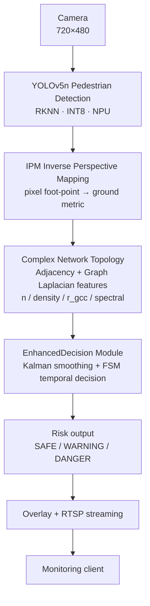

[简体中文](README.md) | **English**

# Lightweight Edge Pedestrian Perception & Risk Decision System (C++)

> **Final-year project**: Real-time pedestrian detection, crowd-gathering analysis and risk-level warning on Luckfox Pico Max (RV1106, 1 TOPS NPU, 256MB).
> Uses a hybrid pipeline: **lightweight perception + geometric correction + graph-topology analysis + temporal risk decision**.

## ✨ Features

- **Lightweight detection**: YOLOv5n + INT8 quantized, real-time pedestrian detection on edge NPU (C++/RKNN)
- **Geometric correction**: Inverse Perspective Mapping (IPM) maps pixel foot-points to ground metric coordinates, removing perspective distortion
- **Complex network topology**: adjacency matrix + Graph Laplacian network features (density / largest connected component ratio / spectral) drive risk scoring; DBSCAN clustering module is standalone with unit tests (optional extension, not in the main loop)
- **Temporal decision**: multi-object Kalman tracking (nearest-neighbor association) + FSM finite-state machine (hysteresis / debounce / DANGER hold); ByteTrack/EMA modules are standalone with unit tests (optional extension)
- **Risk grading**: real-time **SAFE / WARNING / DANGER** three-level output
- **Configurable**: rule thresholds loaded from JSON (`config/default_config.json`)
- **Edge performance**: NEON-optimized preprocessing (CPU preprocess 136ms→33ms), **7.46 FPS** measured, ~11MB RSS, **28h+ long-run sampling (10 points)**: zero watchdog interventions, zero log errors, auto-recovery on service interruption (watchdog + bounded timeouts)
- **Extensible hardware**: dual-servo gimbal, RGB risk LED, debounced push button, voice alert (USB speaker + aplay, level-triggered/preemption/debounce), **touchscreen menu state machine** (LVGL-agnostic: page navigation / 4-key handling / risk-color mapping / throttled parameter refresh, `docs/hardware/lvgl_menu.md`), **ILI9341 SPI display driver** (320x240 RGB565: reset/init command sequence/window/fill-rect/full-frame flush/read ID 0x9341, `src/hardware/ili9341.h`, 123 host tests), **XPT2046 resistive touch driver** (SPI 12-bit ADC coordinates/pressure: command protocol / data extraction / PENIRQ+pressure-threshold touch detect / calibrated coordinate mapping / median anti-noise, `src/hardware/xpt2046.h`, 98 host tests), **Linux board adapter layer** (`/dev/spidevX.Y` full-duplex SPI + sysfs GPIO for DC/RESET/backlight/PENIRQ, `src/hardware/sysfs_spi.{h,cc}`, 40 Linux unit tests compiled and run on the board armv7l), physical switch drivers ready (`docs/hardware/`); **boot-time hardware self-test** (6 PASS/FAIL checks: GPIO/PWM/SPI LCD/USB audio/WiFi/button — demo mode only starts when all pass, `docs/hardware/selftest.md`, **two on-board verification rounds**: fault-tolerance without peripherals + SPI transfer verified after SPI0 enabled); **SPI0 enabled on the real board** (`scripts/enable_spi0_overlay.sh`: Luckfox dynamic device-tree overlay — no kernel/boot.img rebuild; `/dev/spidev0.0` present, systemd boot auto-load, udev 0666 permissions, ioctl mode0/1MHz verified, see `docs/hardware/lvgl_board_port.md`)

## 🏗️ System Architecture



**Pipeline**: lightweight perception (YOLOv5n+INT8) → geometric correction (IPM) → graph topology analysis (Graph Laplacian features) → temporal risk decision (Kalman/FSM) → three-level risk output with RTSP streaming. Detailed architecture: [`docs/ARCHITECTURE.md`](docs/ARCHITECTURE.md).

## 📁 Directory Structure

```
pedestrian-risk-decision/
├── dataset/ # Real datasets
│ ├── images500/ # 500 real COCO images with pedestrians (1–19 people)
│ └── videos50/ # 111 real pedestrian/crowd videos (Mixkit, validated)
├── scripts/ # Test scripts
│ ├── crowd_test.py # image mode (baseline)
│ ├── crowd_test_enhanced.py # video mode (Kalman + FSM)
│ └── cross_build_lvgl.sh # Cross-compile LVGL v8 for the board (ARM smoke-test binary)
├── src/
│ ├── algorithms/ # Algorithm modules (Graph Laplacian/Kalman/ByteTrack/DBSCAN/FSM/IPM/EMA, Python + C++)
│ ├── hardware/ # Hardware drivers (gpio/led/button/servo/pan_tilt/voice_alert/selftest/lcd_menu/ili9341/xpt2046/sysfs_spi)
│ └── luckfox_rtsp_yolov5/ # On-board C++ project (RKNN, NEON-optimized)
├── config/ # Threshold config
├── results/ # Experimental results (image baseline + video enhanced + ablation + edge performance)
├── tests/ # Algorithm unit tests (all pass)
├── docs/ # System principle / architecture / algorithms / hardware / demo / work log
└── config/default_config.json
```

## 📊 Real Datasets

- **Images**: 500 real COCO 2017 images with pedestrians, covering 1–19 people (dispersed 200 / gathered 150 / fairly crowded 138 / crowded 12), with ground-truth person counts
- **Videos**: 111 real Mixkit pedestrian/crowd videos (360p, 3.9–50 s), dual-validated by ffprobe + HOG (111/111 passed)
- All real data, no synthetic/fabricated content; download & validation scripts in `dataset/_work/` and `dataset/videos50/`

## 🧪 Experimental Results (real)

### Image baseline (500 images)
| Metric | Result |
|---|---|
| Overall detection rate | **82.5%** |
| High-density (14+ people) detection rate | **79.4%** |
| Level distribution | SAFE 414 / WARNING 61 / DANGER 25 |

### Video enhancement (111 real videos, Kalman + FSM, full rerun)
- **All 111 real videos (45021 frames)**: level distribution **SAFE 26885 / WARNING 6388 / DANGER 11748**, average **5.86 level switches per video** (median 4.0, FSM hysteresis stabilizes), 66 videos reached DANGER, **31 videos stayed SAFE throughout** (no alert; without ground truth we cannot judge whether these are correct no-alerts or missed alerts)
- Spectral correction term (w4=0.1, score += w4·fiedler/(fiedler+1)·r_gcc) is integrated into the production FSM: mean Fiedler rises monotonically with level (SAFE 0.016 / WARNING 0.465 / DANGER 1.117), batch DANGER frames 7807 → 11748 across 111 videos (spectral features improve high-risk detection)
- Dense crowd (`mixkit_13192`): **DANGER 179 / WARNING 120 / SAFE 6** (305 frames), only 4 switches (fair baseline AND-rule: 48 switches)
- Sparse/empty scene (`mixkit_50134`, normal lighting): SAFE throughout, no alert (no person present)
- **Before/after (fair baseline, same rule as real engine)**: average switches **23.2 → 5.9 (↓74.8%)**; 24 baseline videos reached DANGER vs 66 enhanced; DANGER frames 2190 → 11748 (FSM score includes density weight, spectral features and hold mechanism — more sensitive and more stable than per-frame rule). Details: `results/rerun/_comparison_summary.json`


> Data-mining takeaway: Fiedler vs risk level **Spearman ρ = 0.688** (45021 frames), spectral connectivity strongly correlates with crowd risk.

### Ablation study (component contributions, 6 representative videos)


- **A baseline (no enhancement)**: 33.2 average switches
- **B +Kalman smoothing**: → 8.3 switches (↓75%)
- **C +FSM (no spectral)**: → 4.3 switches (↓87%) — FSM hysteresis / confirm frames / DANGER hold bring most of the stability
- **D complete (+spectral +FSM)**: → 4.3 switches (no extra jitter) and **DANGER frames +152 (+10.2%)** (mixkit_4519 +78, mixkit_4178 +45, mixkit_134 +29) — spectral features improve high-risk detection in medium/dense clusters without side effects on extreme-dense or sparse scenes

Details: `results/rerun/_ablation.json` and `docs/figures/fig_ablation_pro.png`.

### ⚡ Edge performance (Luckfox Pico Max / RV1106)

| Metric | Result |
|---|---|
| Frame rate (after NEON) | **6.30 → 7.46 FPS (+18%)** |
| CPU preprocessing (letterbox+RGB) | **136ms → 33ms (-76%, NEON)** |
| Memory (RSS) | **~10.5-10.9MB** |
| Long-run (systemd watchdog + bounded timeouts) | **28h+ sampling (10 points): zero watchdog interventions, zero log errors** (board restarted once externally, systemd auto-recovered; current process 6h+ continuous) |
| On-board golden tests | **174/174 passed** (NEON vs scalar) |
| Main-loop protection | VI/VENC 1s bounded timeout; 30 consecutive failures → exit, watchdog restarts |

Performance profiling logs & long-run snapshots: `results/edge_board/`.

## 🚀 Deployment

### PC-side testing (GPU, for experiments)
```bash
# Image baseline
python scripts/crowd_test.py --input dataset/images500 --output results/images500_baseline --device 0
# Video enhancement (Kalman + FSM)
python scripts/crowd_test_enhanced.py --input <video.mp4> --output results/video_enhanced --spectral --device 0
```

### On-board deployment (Luckfox RV1106, C++/RKNN)
1. Cross-compile `src/luckfox_rtsp_yolov5/` on an Ubuntu host (see `docs/ARCHITECTURE.md` and `docs/hardware/`)
2. scp the binary to the board, run `sudo ./luckfox_pico_rtsp_yolov5` (systemd-managed + watchdog auto-restart)
3. RTSP stream: `rtsp://<board-ip>:554/live/0`
4. Algorithm modules (graph/Kalman/FSM) C++ headers in `src/algorithms/*.h`, cross-compilable
5. Host unit tests (no board): `cd src/luckfox_rtsp_yolov5 && make test` — covers algorithm modules plus **118 hardware driver tests** (GPIO/LED/button/servo gimbal/voice alert), **80 hardware self-test cases** (GPIO loopback/PWM/SPI LCD ID/USB audio/WiFi/button PASS-FAIL logic), **99 touchscreen menu cases** (page navigation/4-key/risk-color mapping/throttled refresh/NULL tolerance), **123 ILI9341 display driver cases** (reset/init sequence/window params/rect fill clipping/framebuffer/flush/read ID), **98 XPT2046 touch driver cases** (command protocol/12-bit data extraction/PENIRQ+pressure-threshold touch detect/calibrated coordinate mapping/median anti-noise/fault injection), all with in-memory fakes, and **40 Linux board adapter cases** (spidev open/close/transfer failure paths, DC/RESET/backlight/PENIRQ level logic and NULL tolerance — automatically included on Linux/CI)

## 📚 Documentation Index

| Doc | Content |
|---|---|
| `docs/工作日志.md` | Development work log (time / change / commit / progress) |
| `docs/SYSTEM_PRINCIPLE.md` | System principle & algorithm details |
| `docs/ARCHITECTURE.md` | System architecture & module overview |
| `docs/algorithms.md` | Algorithm design (C++/Python dual impl, golden regression) |
| `docs/WEB_VIEWER.md` | Browser-based live monitoring (go2rtc) |
| `docs/DEMO_VIDEO.md` | Real detection demo videos |
| `docs/LUCKFOX_VOICE_ASSISTANT_PLAN.md` | Voice assistant LLM plan (cloud/local) |
| `docs/hardware/` | Hardware extensions (LED/button/servo/voice/display/switch/PCB) |
| `docs/hardware/led_button_driver.md` | RGB LED + button drivers (GPIO abstraction, color mapping, debounce, tests) |
| `docs/hardware/tracking_servo.md` | Dual-servo gimbal tracking (PWM abstraction, angle mapping, PanTilt control, tests) |
| `docs/hardware/voice_module.md` | Voice alert solution (USB speaker recommended / DFPlayer fallback) and alert policy |
| `docs/hardware/selftest.md` | Boot-time hardware self-test (6 PASS/FAIL checks, systemd gate, deploy steps) |
| `docs/hardware/lvgl_menu.md` | Touchscreen menu (LVGL porting research, menu state machine, 99 tests, board adaptation roadmap) |
| `docs/hardware/lvgl_board_port.md` | Board LVGL port prep (ILI9341 integration draft: **Option C — Luckfox dynamic overlay done on the real board** — `scripts/enable_spi0_overlay.sh` enables `/dev/spidev0.0`, systemd boot auto-load + udev 0666 permissions, verified 2026-10-28: ioctl mode0/1MHz OK, survives reboot; ILI9341 display driver + XPT2046 touch driver + **Linux board adapter layer** (`src/hardware/sysfs_spi.{h,cc}`, compiled and run on the board armv7l) all implemented — remaining: wire the ILI9341 panel and calibrate touch once hardware arrives) |

## 🧩 Extensible Modules

- **Voice assistant LLM** (cloud/local): `docs/LUCKFOX_VOICE_ASSISTANT_PLAN.md`
- **PCB backplane** (JLCPCB): `docs/hardware/PCB_BOARD_DESIGN.md`
- **DBSCAN crowd clustering / ByteTrack tracking / EMA smoothing**: standalone implementations with unit tests (`src/algorithms/`), ready to be integrated into the main loop

## 📌 Notes

- This repository is **private**; the author will make it public manually after the project is complete.
- Thesis/defense/review internal documents are kept **locally only** (`H:\毕设论文\`) and NOT uploaded to this repository.
- All experimental data comes from real datasets and is reproducible.