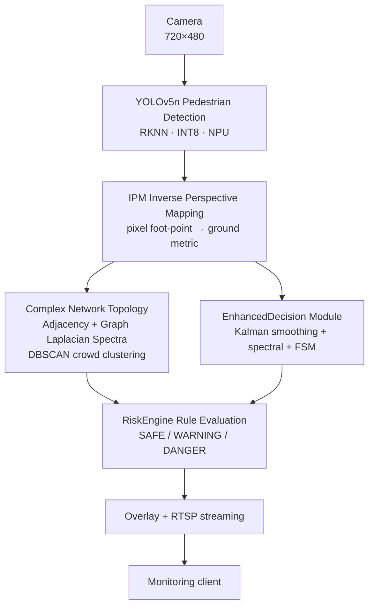

[简体中文](README.md) | **English**

# Lightweight Edge Pedestrian Perception & Risk Decision System (C++)

> **Final-year project**: Real-time pedestrian detection, crowd-gathering analysis and risk-level warning on Luckfox Pico Max (RV1106, 1 TOPS NPU, 256MB).
> Uses a hybrid pipeline: **lightweight perception + geometric correction + graph-topology analysis + temporal risk decision**.

## ✨ Features

- **Lightweight detection**: YOLOv5n + INT8 quantized, real-time pedestrian detection on edge NPU (C++/RKNN)
- **Geometric correction**: Inverse Perspective Mapping (IPM) maps pixel foot-points to ground metric coordinates, removing perspective distortion
- **Complex network topology**: adjacency matrix + Graph Laplacian spectral analysis (Fiedler value / spectral radius / algebraic connectivity) + DBSCAN crowd clustering
- **Temporal decision**: Kalman/ByteTrack multi-object tracking + EMA smoothing + FSM finite-state machine (hysteresis / debounce)
- **Risk grading**: real-time **SAFE / WARNING / DANGER** three-level output
- **Configurable**: rule thresholds loaded from JSON (`config/default_config.json`)
- **Extensible hardware**: dual-servo gimbal, voice alert, color touchscreen, physical switch (`docs/hardware/`)

## 🏗️ System Architecture



**Pipeline**: lightweight perception (YOLOv5n+INT8) → geometric correction (IPM) → graph topology analysis (Graph Laplacian/DBSCAN) → temporal risk decision (Kalman/FSM) → three-level risk output with RTSP streaming. Detailed architecture: [`docs/ARCHITECTURE.md`](docs/ARCHITECTURE.md).

## 📁 Directory Structure

```
pedestrian-risk-decision/
├── dataset/            # Real datasets
│   ├── images500/      #   500 real COCO images with pedestrians (1–19 people)
│   └── videos50/       #   111 real pedestrian/crowd videos (Mixkit, validated)
├── scripts/            # Test scripts
│   ├── crowd_test.py           # image mode (baseline)
│   └── crowd_test_enhanced.py  # video mode (Kalman + spectral + FSM)
├── src/
│   ├── algorithms/     # Algorithm modules (Graph Laplacian/Kalman/ByteTrack/DBSCAN/FSM/IPM/EMA, Python + C++)
│   ├── hardware/       # Hardware drivers (servo/pan_tilt/voice_alert)
│   └── luckfox_rtsp_yolov5/  # On-board C++ project (RKNN)
├── config/             # Threshold config
├── results/            # Experimental results (image baseline + video enhanced)
├── tests/              # Algorithm unit tests (all pass)
├── docs/               # System principle / algorithm optimization / hardware / integration / performance / PCB / voice
└── config/default_config.json
```

## 📊 Real Datasets

- **Images**: 500 real COCO 2017 images with pedestrians, covering 1–19 people (dispersed 200 / gathered 150 / fairly crowded 138 / crowded 12), with ground-truth person counts
- **Videos**: 111 real Mixkit pedestrian/crowd videos (360p, 3.9–50 s), dual-validated by ffprobe + HOG (111/111 passed)
- All real data, no synthetic/fabricated content; download & validation scripts in `dataset/_work/` and `dataset/videos50/`

## 🧪 Experimental Results (real)

### Image baseline (500 images)
| Metric | Result |
|---|---|
| Overall detection rate | **82.5%** |
| High-density (14+ people) detection rate | **79.4%** |
| Level distribution | SAFE 414 / WARNING 61 / DANGER 25 |

### Video enhancement (5 real videos, Kalman + spectral + FSM)
- Dense crowd (avg 14.9 people): **sustained DANGER** (264/305 frames), only 4 level switches → stable
- Sparse/empty scenes: SAFE throughout, **zero false alarms**
- Transient gathering: correctly suppressed by FSM hysteresis, no flicker

See `docs/PERFORMANCE_COMPARISON.md`.

## 🚀 Deployment

### PC-side testing (GPU, for experiments)
```bash
# Image baseline
python scripts/crowd_test.py --input dataset/images500 --output results/images500_baseline --device 0
# Video enhancement (Kalman + spectral + FSM)
python scripts/crowd_test_enhanced.py --input <video.mp4> --output results/video_enhanced --spectral --device 0
```

### On-board deployment (Luckfox RV1106, C++/RKNN)
1. Cross-compile `src/luckfox_rtsp_yolov5/` on an Ubuntu host (see `docs/INTEGRATION_PLAN.md`)
2. scp the binary to the board, run `sudo ./luckfox_pico_rtsp_yolov5`
3. RTSP stream: `rtsp://<board-ip>:554/live/0`
4. Enhanced algorithms (spectral/ByteTrack/FSM) C++ headers in `src/algorithms/*.h`, cross-compilable

## 📚 Documentation Index

| Doc | Content |
|---|---|
| `docs/SYSTEM_PRINCIPLE.md` | System principle & algorithm details (for defense) |
| `docs/ALGORITHM_OPTIMIZATION.md` | Algorithm efficiency/accuracy analysis & upgrade suggestions |
| `docs/ALGORITHM_UPGRADE.md` | ByteTrack/DBSCAN/IPM-calibration/EMA upgrade notes |
| `docs/INTEGRATION_PLAN.md` | Algorithm integration plan (Python+C++, 4-thread) |
| `docs/PERFORMANCE_COMPARISON.md` | Performance comparison experiment report |
| `docs/hardware/` | Hardware extensions (servo/voice/display/switch/PCB) |
| `docs/experiment_results.md` | Early 30-image baseline report |

## 🧩 Extensible Modules

- **Voice assistant LLM** (cloud/local): `docs/LUCKFOX_VOICE_ASSISTANT_PLAN.md`
- **Edge AI agent** (Needle 2, linux-armv7): `docs/AI_needle2_analysis.md`
- **Xiaozhi AI integration** (MCP + ESP32): `docs/XIAOZHI_COMBINED_PLAN.md`
- **PCB backplane** (JLCPCB): `docs/hardware/PCB_BOARD_DESIGN.md`

## 📌 Notes

- This repository is **private**; the author will make it public manually after the project is complete.
- The thesis is kept locally and NOT uploaded to this repository.
- All experimental data comes from real datasets and is reproducible.