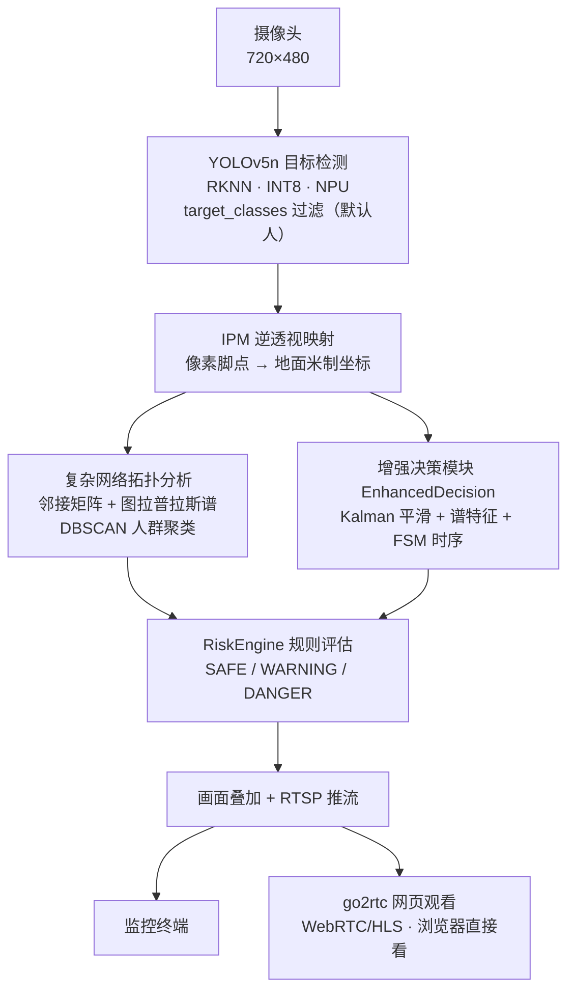
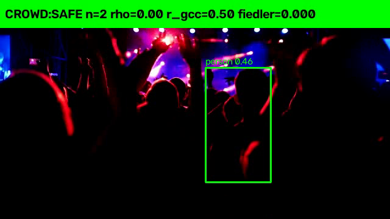

**简体中文** | [English](README.en.md)

# 基于 C++ 的边缘端轻量化行人感知与风险决策软件系统

> **毕设项目**：在 Luckfox Pico Max（RV1106，1TOPS NPU，256MB）上实现实时行人检测、人群聚集分析与风险分级预警。
> 采用"**前端轻量化感知 + 几何空间校正 + 图论拓扑分析 + 时序风险决策**"复合算法流水线。

## ✨ 特性

- **轻量化检测**：YOLOv5n + INT8 量化，在边缘端 NPU 上实时检测行人（C++/RKNN）
- **几何校正**：逆透视映射（IPM）把像素脚点映射到地面米制坐标，消除透视畸变
- **复杂网络拓扑**：邻接矩阵 + 图拉普拉斯谱分析（Fiedler 值/谱半径/代数连通度）+ DBSCAN 人群聚类
- **时序决策**：Kalman/ByteTrack 多目标跟踪 + EMA 平滑 + FSM 有限状态机（滞回防抖）
- **风险分级**：实时输出 **SAFE / WARNING / DANGER** 三级风险
- **多目标可切换**：通过 `target_classes` 配置检测目标类别（人[0]/车辆[2,5,7,3]/狗[16]/猫[15]/动物[14,18,19,20,21]），一键切换危险目标聚集报警
- **网页免安装观看**：开发板 go2rtc 转 WebRTC/HLS，手机/电脑浏览器直接打开网页看监控（`docs/WEB_VIEWER.md`）
- **可配置**：规则阈值、目标类别与**外部 IPM 标定文件**通过 JSON 配置文件加载（`config/default_config.json`；`homography_file` 指向文本 3x3 单应，相机位姿变化无需重编译）
- **可扩展硬件**：支持双舵机云台、语音告警、彩色触控屏、物理开关（`docs/hardware/`）

## 🏗️ 系统架构



**流水线**：前端轻量化感知（YOLOv5n+INT8）→ 几何空间校正（IPM）→ 图论拓扑分析（图拉普拉斯/DBSCAN）→ 时序风险决策（Kalman/FSM）→ 输出三级风险并 RTSP 推流。详细架构见 [`docs/ARCHITECTURE.md`](docs/ARCHITECTURE.md)。

## 📁 目录结构

```
pedestrian-risk-decision/
├── dataset/            # 真实数据集
│   ├── images500/      #   500 张 COCO 真实含行人图片（1~19 人）
│   └── videos50/       #   111 条真实行人/人群视频（Mixkit，已校验）
├── scripts/            # 测试脚本
│   ├── crowd_test.py           # 图片模式（基线）
│   ├── crowd_test_enhanced.py  # 视频模式（Kalman+谱特征+FSM 增强）
│   └── start_demo.sh         # 开发板一键启动（RTSP + 网页观看，答辩用）
├── src/
│   ├── algorithms/     # 算法模块（图拉普拉斯/Kalman/ByteTrack/DBSCAN/FSM/IPM/EMA，含 Python+C++ 接口）
│   ├── hardware/       # 硬件驱动（servo/pan_tilt/voice_alert）
│   └── luckfox_rtsp_yolov5/  # 开发板 C++ 工程（RKNN）
├── config/             # 阈值配置
├── results/            # 实验结果（图片基线 + 视频增强）
├── tests/              # 算法单元测试（全通过）
├── docs/               # 系统原理/算法优化/硬件方案/集成方案/性能对比/PCB设计/语音方案
└── config/default_config.json
```

## 📊 真实数据集

- **图片**：500 张 COCO 2017 真实含行人图片，覆盖 1~19 人（分散 200 / 聚集 150 / 较拥挤 138 / 拥挤 12），含 ground-truth 人数标注
- **视频**：111 条 Mixkit 真实行人/人群视频（360p，3.9~50 秒），ffprobe + HOG 双重校验（111/111 通过）
- 全部为真实数据，无合成/编造；下载脚本与校验脚本在 `dataset/_work/` 和 `dataset/videos50/`

## 🧪 实验结果（真实）

### 图片基线（500 张）
| 指标 | 结果 |
|---|---|
| 检出率（总体） | **82.5%** |
| 高密度图（14+人）检出率 | **76.7%** |
| 等级分布 | SAFE 414 / WARNING 61 / DANGER 25 |

  


### 视频增强（真实视频，Kalman+谱特征+FSM，111 条全量重跑）
- **全量 111 条真实视频（45021 帧）**：等级分布 **SAFE 25669 / WARNING 11545 / DANGER 7807**，平均每条等级切换 **4.00 次**（FSM 滞回稳定），40 条出现 DANGER，**31 条全程 SAFE（零误报）**
- 密集人群（`mixkit_13192`）：**DANGER 179 / WARNING 120 / SAFE 6**（305 帧），等级切换仅 4 次 → 稳定（逐帧规则基线为 46 次/视频）
- 稀疏/无人场景（`mixkit_13265`）：281 帧全程 SAFE，**零误报**
- 算法前后对比见 `docs/COMPARISON.md`（含增强代价/下降方面）；全量明细见 `results/rerun/`

  


### 🎬 真实检测效果视频

**增强算法效果视频**（点击封面观看，真实视频处理结果）：

- 人群聚集场景（SAFE → WARNING → DANGER 风险过渡，FSM 稳定）：
  [](results/demo/mixkit_134_enhanced.mp4)

- 稀疏/无人场景（零误报）：
  [](results/video_enhanced_fsm/mixkit_13265_enhanced.mp4)

> 视频为真实数据集（Mixkit）经 `scripts/crowd_test_enhanced.py`（Kalman + 谱特征 + FSM）处理生成；逐帧时间线 JSON 在 `results/rerun/video_enhanced/` 与 `results/video_enhanced_fsm/`。

详见 `docs/PERFORMANCE_COMPARISON.md`。

## 🚀 部署方法

### PC 端测试（GPU，用于实验）
```bash
# 图片基线
python scripts/crowd_test.py --input dataset/images500 --output results/images500_baseline --device 0
# 视频增强（Kalman + 谱特征 + FSM）
python scripts/crowd_test_enhanced.py --input <video.mp4> --output results/video_enhanced --spectral --device 0
```

### 开发板部署（Luckfox RV1106，C++/RKNN）
1. 老电脑（Ubuntu）用交叉编译工具链编译 `src/luckfox_rtsp_yolov5/` 工程（见 `docs/INTEGRATION_PLAN.md`）
2. 产物 scp 到开发板，`sudo ./luckfox_pico_rtsp_yolov5` 运行
3. RTSP 推流：`rtsp://<板子IP>:554/live/0`
4. 增强算法（谱特征/ByteTrack/FSM）的 C++ 头文件在 `src/algorithms/*.h`，可交叉编译集成
5. **答辩一键启动**：`sudo bash scripts/start_demo.sh` 自动拉起 RTSP + 网页观看并打印访问地址（见 `docs/WEB_VIEWER.md`）

### C++ 算法主机测试与构建（无需开发板）
```bash
cd src/luckfox_rtsp_yolov5
make test        # 编译并运行增强决策/JSON 配置/阈值引擎单元测试（仅需 g++）
# 等价 CMake 方式：
#   cmake -S . -B build && cmake --build build && ctest --test-dir build
```
- 测试覆盖：`EnhancedDecision`（Kalman+谱特征+FSM 确定性输出）、`minijson` JSON 解析、`RiskConfig` 运行时阈值读取。
- 交叉编译完整工程：`make luckfox LUCKFOX_SDK_ROOT=<SDK路径>`（需 Luckfox SDK 库与工具链）。
- 阈值通过 `config/default_config.json` 运行时加载（`RiskEngine::setConfig`），失败自动回退默认值，论文“可配置”承诺在 C++ 端落地。

## 📚 文档索引

| 文档 | 内容 |
|---|---|
| `docs/SYSTEM_PRINCIPLE.md` | 系统实现原理与算法详解（答辩用） |
| `docs/ALGORITHM_OPTIMIZATION.md` | 算法效率/准确度分析与升级建议 |
| `docs/ALGORITHM_UPGRADE.md` | ByteTrack/DBSCAN/IPM标定/EMA 升级说明 |
| `docs/INTEGRATION_PLAN.md` | 算法集成方案（Python+C++，四线程架构） |
| `docs/WEB_VIEWER.md` | 网页免安装观看监控（go2rtc，手机/电脑浏览器） |
| `docs/WIFI_SETUP.md` | 答辩现场无线连接方案（USB WiFi 自动连手机热点） |
| `docs/DEMO_SCRIPT.md` | 答辩现场演示脚本（讲稿/故障预案，8-10分钟） |
| `docs/PERFORMANCE_COMPARISON.md` | 性能对比实验报告 |
| `docs/COMPARISON.md` | 增强算法前后对比（真实数据 + 代价/下降方面） |
| `docs/hardware/` | 硬件扩展（舵机/语音/大屏/开关/PCB） |
| `docs/experiment_results.md` | 30 张图基线实验报告（早期） |

## 🧩 可扩展模块（后续）

- **语音对话大模型**（网络/本地双方案）：`docs/LUCKFOX_VOICE_ASSISTANT_PLAN.md`
- **端侧 AI 智能体**（Needle 2，linux-armv7 支持）：`docs/AI_needle2_analysis.md`
- **小智 AI 结合**（MCP + ESP32）：`docs/XIAOZHI_COMBINED_PLAN.md`
- **PCB 底板打样**：`docs/hardware/PCB_BOARD_DESIGN.md`

## 📌 说明

- 本仓库为**私人仓库**，毕设完成后由作者手动公开。
- 论文保存在本地，不在本仓库上传。
- 所有实验数据均来自真实数据集，可复现。