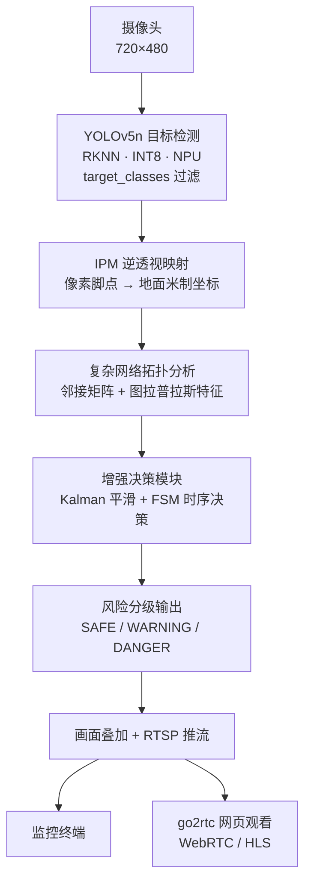
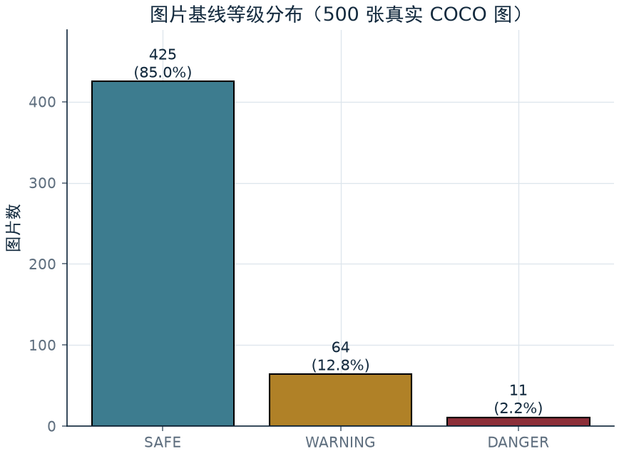
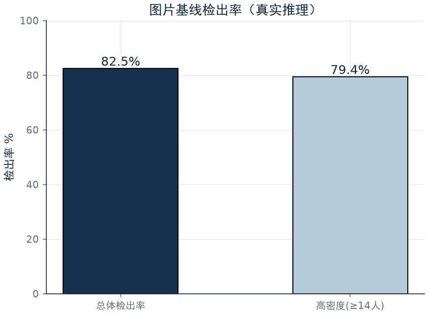
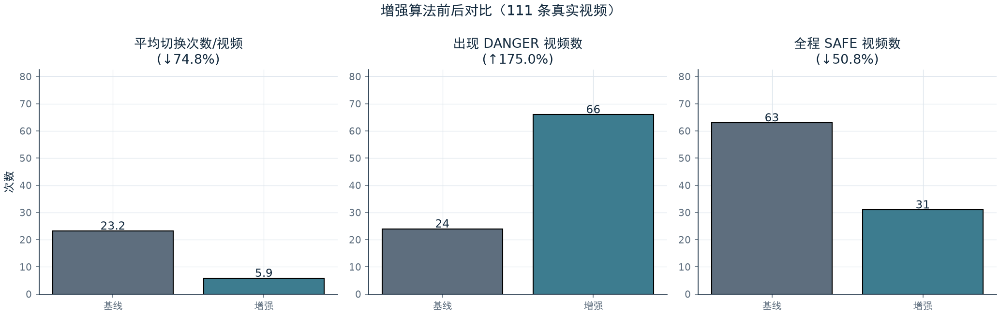
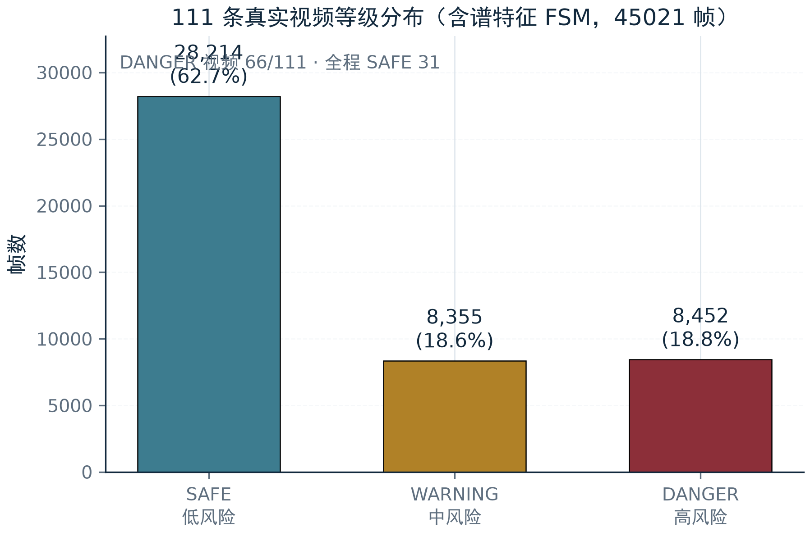
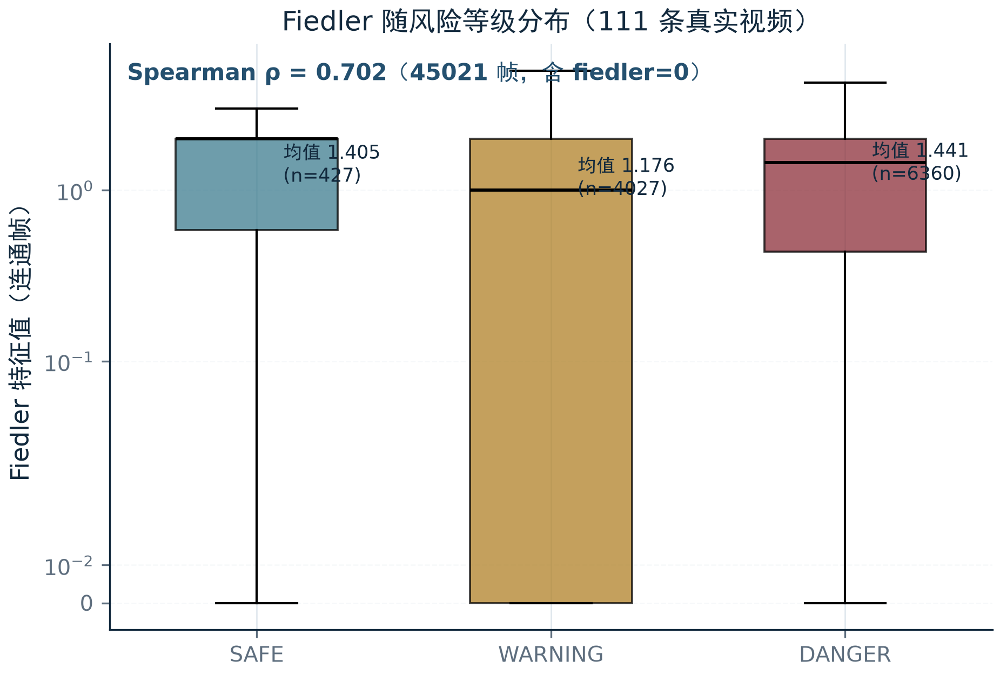
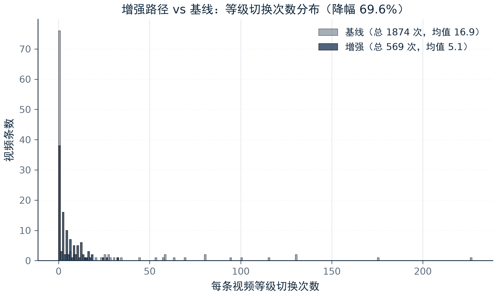
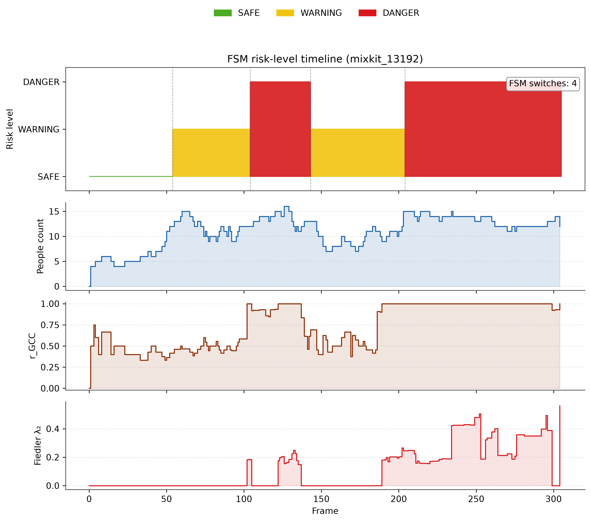
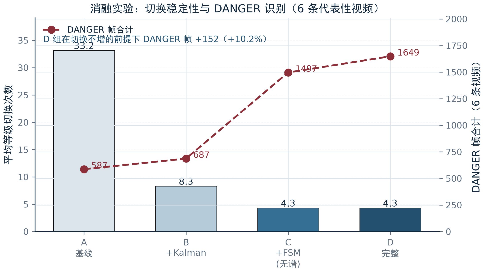

**简体中文** | [English](README.en.md)

# 基于 C++ 的边缘端轻量化行人感知与风险决策软件系统

在 Luckfox Pico Max（RV1106，1 TOPS NPU，256 MB 内存）上实现的实时行人检测与人群风险分级预警系统。

技术路线：轻量化目标检测 → 逆透视几何校正 → 图论拓扑分析 → 时序风险决策。


## 1. 项目简介

城市公共空间的人群聚集会带来踩踏等安全风险，而传统监控只能事后回看。本系统把检测、空间校正、聚集分析与风险决策全部下沉到一块 256 MB 内存的低成本边缘设备上，使摄像头本身具备实时风险判断能力。

系统输入为摄像头视频流，输出为画面叠加的三级风险状态（SAFE / WARNING / DANGER），可驱动现场 LED 警示灯、云台跟踪与语音播报。

核心设计取舍：不追求检测精度上限，而是在算力与内存受限的前提下，用几何校正把像素坐标还原为地面米制坐标，再用图论特征刻画人群的空间聚集形态，最后用有限状态机把逐帧判断平滑为稳定的风险等级，避免告警反复跳变。

## 2. 主要功能

- **边缘端实时检测**：YOLOv5n + INT8 量化，RKNN NPU 推理，C++ 实现，实测 7.69 FPS
- **几何空间校正**：逆透视映射（IPM）把像素脚点映射到地面米制坐标，消除透视畸变
- **人群拓扑分析**：邻接矩阵 + 图拉普拉斯网络特征（人数、密度、最大连通分量占比、谱特征）驱动风险评分
- **时序风险决策**：多目标 Kalman 跟踪 + FSM 有限状态机（滞回防抖、确认帧、DANGER 保持）
- **三级风险分级**：实时输出 SAFE / WARNING / DANGER，并叠加到画面推流
- **硬件联动**：三色 LED 警示灯、双舵机云台跟踪、USB 喇叭语音告警、开机硬件自检
- **网页观看**：板端 go2rtc 转 WebRTC/HLS，手机或电脑浏览器直接打开监控画面
- **可配置**：阈值、检测目标类别、IPM 标定文件均通过 JSON 配置加载，无需重编译

## 3. 系统架构



各模块的算法细节见 [`docs/SYSTEM_PRINCIPLE.md`](docs/SYSTEM_PRINCIPLE.md) 与 [`docs/ARCHITECTURE.md`](docs/ARCHITECTURE.md)。

## 4. 运行环境

| 环节 | 环境 |
|---|---|
| 算法实验（Python） | Python 3.x、PyTorch、OpenCV、NumPy、Matplotlib |
| 板端推理（C++） | Luckfox Pico Max / RV1106、RKNN SDK、arm-linux 交叉编译工具链 |
| 主机单元测试（C++） | g++（无需开发板，硬件模块用内存替身测试） |

## 5. 目录结构

```
pedestrian-risk-decision/
├── dataset/
│   ├── images500/           # 500 张 COCO 真实含行人图片
│   └── videos50/            # 111 条真实行人视频（Mixkit）
├── scripts/                 # 实验与部署脚本
│   ├── crowd_test.py        # 图片模式（基线）
│   ├── crowd_test_enhanced.py  # 视频模式（Kalman + FSM 增强）
│   ├── start_demo.sh        # 开发板一键启动
│   └── cross_build_lvgl.sh  # LVGL 交叉编译
├── src/
│   ├── algorithms/          # 图拉普拉斯 / Kalman / ByteTrack / DBSCAN / FSM / IPM
│   ├── hardware/            # GPIO / LED / 按键 / 舵机 / 语音 / 自检 / 屏幕 / 触摸
│   └── luckfox_rtsp_yolov5/ # 开发板 C++ 工程（RKNN + NEON）
├── config/                  # 阈值与标定配置
├── results/                 # 实验结果（图片基线 / 视频增强 / 消融 / 真机性能）
├── tests/                   # Python 单元测试
└── docs/                    # 原理 / 架构 / 算法 / 硬件 / 部署文档
```

## 6. 数据集

- **图片**：500 张 COCO 2017 真实含行人图片，覆盖 1–19 人（分散 200 张 / 聚集 150 张 / 较拥挤 138 张 / 拥挤 12 张），含 ground-truth 人数标注
- **视频**：111 条 Mixkit 真实行人视频（360p，3.9–50 秒），经 ffprobe 与 HOG 检测双重校验，111/111 通过

均为真实公开数据，无合成样本。

## 7. 实验结果

### 7.1 图片基线（500 张）

检测配置：`yolov8n.pt`、`imgsz=640`、`conf=0.35`（取自 `config/default_config.json` 的 `conf_threshold`，与板端运行时一致）。

| 指标 | 结果 |
|---|---|
| 检出率（总体） | 65.85 % |
| 高密度图（≥14 人）检出率 | 49.71 % |
| 人数估计 MAE / RMSE | 2.330 / 3.733 |
| Pearson 相关系数 r | 0.7588 |
| 等级分布 | SAFE 425 / WARNING 64 / DANGER 11 |

| GT 人数分桶 | 图片数 | 检出率 |
|---|---|---|
| 1–3 人 | 200 | 83.38 % |
| 4–9 人 | 150 | 62.61 % |
| 10–13 人 | 138 | 65.81 % |
| 14–19 人 | 12 | 49.71 % |

检出率 = 检出框数 / 人工标注 GT 总数（3089 人），500 张全量、无筛选。




### 7.2 视频增强（111 条真实视频，45021 帧）

检测配置与图片基线一致（`conf=0.35`）。

等级分布 SAFE 30672（68.1 %）/ WARNING 8789（19.5 %）/ DANGER 5560（12.3 %），平均每条等级切换 5.13 次（中位数 2，最大 32），38 条出现 DANGER，38 条全程 SAFE（无人工真值，无法判定未报警属正确不报还是漏报）。

与规则基线的公平对比（同一 conf、同一 IPM 单应、同一 AND 判定语义）：等级切换总次数 1874 → 569（下降 69.6 %），平均每条 16.88 → 5.13 次，FSM 的滞回 / 确认帧 / 保持期大幅抑制逐帧抖动；DANGER 帧 1270 → 5560，谱特征修正项把密集人群场景判为高风险的比例显著提高。

谱特征修正项（w4 = 0.1）接入生产 FSM 后，Fiedler 均值随等级单调上升：SAFE 0.0225 / WARNING 0.709 / DANGER 1.0147。







Fiedler 与风险等级的 Spearman ρ = 0.729（45021 帧全量），谱连通度与人群聚集风险显著正相关。

### 7.3 消融实验（6 条代表性视频）



| 配置 | 平均等级切换次数 | DANGER 帧 |
|---|---|---|
| A 基线（无增强） | 41.8 | 466 |
| B + Kalman 平滑 | 10.5（下降 74.9 %） | 608 |
| C + FSM（无谱特征） | 4.3（下降 89.7 %） | 1237（基准） |
| D 完整（+ 谱特征） | 4.3 | 1360（+123 帧，+9.9 %） |

结论：FSM 的滞回与保持机制贡献了主要稳定性；谱特征在不增加切换次数的前提下提升高风险识别率，对极密与稀疏场景无副作用。

### 7.4 真机性能（Luckfox Pico Max / RV1106）

| 指标 | 结果 |
|---|---|
| 帧率 | 7.69 FPS（受控 66 个 1 s 窗口统计）；开启推理降频后 11.86 FPS |
| 单帧耗时分解 | 推理 91.5 ms（71 %）/ 预处理 31.0 ms（24 %）/ 编码 4.0 ms / 绘制 2.4 ms / 决策 0.02 ms |
| CPU 预处理优化 | 136 ms → 31.0 ms（NEON 优化，-77 %） |
| 内存占用（RSS） | 13.8 MiB |
| 板端黄金测试 | 174 / 174 通过（NEON vs 标量对照） |
| 稳定性 | NRestarts = 0，观察期无新增 core dump，RTSP 正常 |

帧率瓶颈定位在 NPU 推理（占 71 %），而非谱特征计算（决策仅 0.02 ms）。这一结论修正了开发初期的假设。

> 说明：真机长稳采集目前仅 10 条采样，尚未完成，如实记录于 [`docs/FACTS.md`](docs/FACTS.md)。

### 7.5 检测效果视频

| 场景 | 说明 | 视频 |
|---|---|---|
| 人群聚集 | SAFE → WARNING → DANGER 风险过渡 | [观看](results/demo/mixkit_134_enhanced.mp4) |
| 稀疏/无人 | 真实少人场景，未触发告警 | [观看](results/demo/mixkit_50134_enhanced.mp4) |

视频由 `scripts/crowd_test_enhanced.py` 处理生成，逐帧时间线见 `results/rerun/video_enhanced/`。

## 8. 部署与运行

### 8.1 PC 端算法实验

```bash
# 图片基线
python scripts/crowd_test.py --input dataset/images500 --output results/images500_baseline --device 0

# 视频增强（Kalman + FSM）
python scripts/crowd_test_enhanced.py --input <video.mp4> --output results/video_enhanced --spectral --device 0
```

### 8.2 开发板部署

1. 在 Ubuntu 主机用 Luckfox SDK 工具链交叉编译 `src/luckfox_rtsp_yolov5/`
2. 产物 scp 到开发板，`sudo ./luckfox_pico_rtsp_yolov5` 运行（systemd 托管 + 看门狗自动重启）
3. RTSP 推流地址：`rtsp://<板子IP>:554/live/0`
4. 一键启动：`sudo bash scripts/start_demo.sh`（自动拉起 RTSP 与网页观看）

### 8.3 C++ 主机单元测试（无需开发板）

```bash
cd src/luckfox_rtsp_yolov5
make test
```

覆盖增强决策（Kalman + FSM）、JSON 解析、运行时阈值读取、NEON 与标量对照，以及全部硬件驱动模块（用内存替身模拟，无需真实硬件）。

## 9. 文档

| 文档 | 内容 |
|---|---|
| [`docs/SYSTEM_PRINCIPLE.md`](docs/SYSTEM_PRINCIPLE.md) | 系统实现原理与算法详解 |
| [`docs/ARCHITECTURE.md`](docs/ARCHITECTURE.md) | 系统架构与模块划分 |
| [`docs/algorithms.md`](docs/algorithms.md) | 算法设计（C++ / Python 双实现与黄金回归） |
| [`docs/WEB_VIEWER.md`](docs/WEB_VIEWER.md) | 网页观看监控（go2rtc）与本地视频流兜底 |
| [`docs/AUDIT_20261030_ROUND3.md`](docs/AUDIT_20261030_ROUND3.md) | 真机问题排查与修复记录 |
| [`docs/FACTS.md`](docs/FACTS.md) | 全部实验数字的溯源表 |
| [`docs/DATA_REVISION.md`](docs/DATA_REVISION.md) | 2026-11-01 数据重跑记录（conf 口径修正与新旧对比） |
| [`docs/CROSSCHECK.md`](docs/CROSSCHECK.md) | 论文 / README / 产物三向交叉验证（基于 10-26 旧口径，结论见 DATA_REVISION.md） |
| [`docs/hardware/`](docs/hardware/) | 硬件扩展（LED / 按键 / 舵机 / 语音 / 屏幕 / 触摸 / PCB） |
| [`docs/工作日志.md`](docs/工作日志.md) | 开发进度日志 |

## 说明

- 所有实验数据均来自真实公开数据集，结果可通过 `scripts/` 下的脚本复现。
- 论文、答辩材料与评审意见等内部文档仅保存在本地，不入库；本仓库仅保留代码、配置、测试与技术文档。
- 后续可扩展方向：语音对话大模型接入、PCB 底板打样、DBSCAN 聚类与 ByteTrack 跟踪接入主循环（模块已独立实现并通过单测）。
