**简体中文** | [English](README.en.md)

# 基于 C++ 的边缘端轻量化行人感知与风险决策软件系统

> **项目**：在 Luckfox Pico Max（RV1106，1TOPS NPU，256MB）上实现实时行人检测、人群聚集分析与风险分级预警。
> 采用"**前端轻量化感知 + 几何空间校正 + 图论拓扑分析 + 时序风险决策**"复合算法流水线。

## ✨ 特性

- **轻量化检测**：YOLOv5n + INT8 量化，在边缘端 NPU 上实时检测行人（C++/RKNN）
- **几何校正**：逆透视映射（IPM）把像素脚点映射到地面米制坐标，消除透视畸变
- **复杂网络拓扑**：邻接矩阵 + 图拉普拉斯网络特征（密度/最大连通分量占比/谱特征）驱动风险评分；DBSCAN 聚类模块独立实现并通过单测（可选扩展，未接入主循环）
- **时序决策**：多目标 Kalman 跟踪（最近邻关联）+ FSM 有限状态机（滞回防抖/确认帧/DANGER 保持）；ByteTrack/EMA 模块独立实现并通过单测（可选扩展）
- **风险分级**：实时输出 **SAFE / WARNING / DANGER** 三级风险
- **多目标可切换**：通过 `target_classes` 配置检测目标类别（人[0]/车辆[2,5,7,3]/狗[16]/猫[15]/动物[14,18,19,20,21]），一键切换危险目标聚集报警
- **真机性能**：NEON 优化预处理（CPU 预处理 136ms→33ms），实测 **7.46 FPS**、内存 ~11MB、**28 小时+ 长稳采样（10 点）**：看门狗 0 介入、日志 0 错误，服务中断自动恢复（看门狗 + 有限超时）
- **网页免安装观看**：开发板 go2rtc 转 WebRTC/HLS，手机/电脑浏览器直接打开网页看监控（`docs/WEB_VIEWER.md`）；**本地视频流兜底演示**（P2-1）：`scripts/setup_go2rtc_demo_stream.sh` 一键向 go2rtc 注入预录增强视频 demo 流，现场镜头前无人时也能演示 DANGER 切换（配置工具 14 项主机测试 + 4 项 shell 测试由 CI 覆盖）
- **可配置**：规则阈值、目标类别与**外部 IPM 标定文件**通过 JSON 配置文件加载（`config/default_config.json`；`homography_file` 指向文本 3x3 单应，相机位姿变化无需重编译）
- **可扩展硬件**：双舵机云台、三色 LED 风险灯、防抖按键、语音告警（USB 喇叭 + aplay，等级触发/抢占/防重复）、**触摸屏菜单状态机**（LVGL 前端无关：页面导航/四键/风险等级颜色映射/参数节流刷新，`docs/hardware/lvgl_menu.md`）、**ILI9341 SPI 显示驱动**（320×240 RGB565：复位/初始化命令序列/窗口/矩形填充/整帧 flush/读 ID 0x9341，`src/hardware/ili9341.h`，123 项主机测试）、**XPT2046 电阻触摸驱动**（SPI 12 位 ADC 坐标/压力：命令协议/数据提取/PENIRQ+压力阈值触摸判定/校准坐标转换/中值抗噪，`src/hardware/xpt2046.h`，98 项主机测试）、**Linux 板端适配层**（`/dev/spidevX.Y` 全双工 SPI + DC/RESET/背光/PENIRQ 的 sysfs GPIO 实现，`src/hardware/sysfs_spi.{h,cc}`，40 项 Linux 单元测试，已在开发板 armv7l 真机编译运行通过）、物理开关驱动已就绪（`docs/hardware/`）；**开机硬件自检**（GPIO/PWM/SPI 屏幕/USB 声卡/WiFi/按键 6 项 PASS/FAIL，全部通过才进入演示模式，`docs/hardware/selftest.md`，**已在开发板两轮真机验证**：无外设容错运行 + SPI0 启用后 SPI 传输实测打通）；**SPI0 已真机落地**（`scripts/enable_spi0_overlay.sh`：Luckfox 动态设备树 overlay，无需重编内核/boot.img；`/dev/spidev0.0` 已生成、systemd 开机自动加载、udev 0666 权限、ioctl 实测 mode0/1MHz，见 `docs/hardware/lvgl_board_port.md`）

## 🏗️ 系统架构

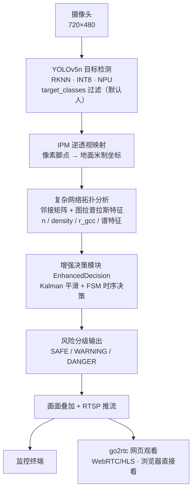

**流水线**：前端轻量化感知（YOLOv5n+INT8）→ 几何空间校正（IPM）→ 图论拓扑分析（图拉普拉斯特征）→ 时序风险决策（Kalman/FSM）→ 输出三级风险并 RTSP 推流。详细架构见 [`docs/ARCHITECTURE.md`](docs/ARCHITECTURE.md)。

## 📁 目录结构

```
pedestrian-risk-decision/
├── dataset/ # 真实数据集
│ ├── images500/ # 500 张 COCO 真实含行人图片（1~19 人）
│ └── videos50/ # 111 条真实行人/人群视频（Mixkit，已校验）
├── scripts/ # 测试脚本
│ ├── crowd_test.py # 图片模式（基线）
│ ├── crowd_test_enhanced.py # 视频模式（Kalman+FSM 增强）
│ ├── start_demo.sh # 开发板一键启动（RTSP + 网页观看）
│ └── cross_build_lvgl.sh # LVGL v8 交叉编译（老电脑→开发板 ARM 产物 + 冒烟测试）
├── src/
│ ├── algorithms/ # 算法模块（图拉普拉斯/Kalman/ByteTrack/DBSCAN/FSM/IPM/EMA，含 Python+C++ 接口）
│ ├── hardware/ # 硬件驱动（gpio/led/button/servo/pan_tilt/voice_alert/selftest/lcd_menu/ili9341/xpt2046/sysfs_spi）
│ └── luckfox_rtsp_yolov5/ # 开发板 C++ 工程（RKNN，NEON 优化）
├── config/ # 阈值配置
├── results/ # 实验结果（图片基线 + 视频增强 + 消融 + 真机性能）
├── tests/ # 算法单元测试（全通过）
├── docs/ # 系统原理/架构/算法/硬件/演示/工作日志
└── config/default_config.json
```

## 📊 真实数据集

- **图片**：500 张 COCO 2017 真实含行人图片，覆盖 1~19 人（分散 200 / 聚集 150 / 较拥挤 138 / 拥挤 12），含 ground-truth 人数标注
- **视频**：111 条 Mixkit 真实行人/人群视频（360p，3.9~50 秒），ffprobe + HOG 双重校验（111/111 通过）
- 全部为真实数据，无合成/编造；下载脚本与校验脚本在 `dataset/_work/` 和 `dataset/videos50/`

## 🧪 实验结果（真实）

### 图片基线（500 张）
| 指标 | 结果 |
|---|---|
| 检出率（总体） | **82.5%** |
| 高密度图（14+人）检出率 | **79.4%** |
| 等级分布 | SAFE 414 / WARNING 61 / DANGER 25 |

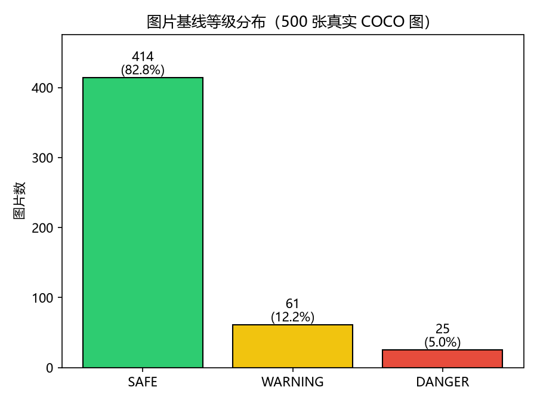 
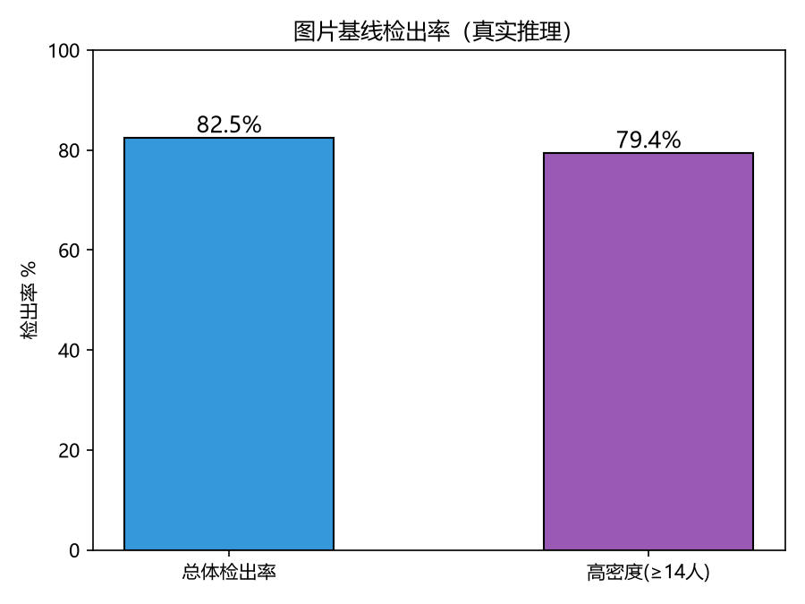

### 视频增强（真实视频，Kalman+谱特征+FSM，111 条全量重跑）
- **全量 111 条真实视频（45021 帧）**：等级分布 **SAFE 26885 / WARNING 6388 / DANGER 11748**，平均每条等级切换 **5.86 次**（中位数 4.0，FSM 滞回稳定），66 条出现 DANGER，**31 条全程输出 SAFE（系统未报警）**（无人工真值，无法判定未报警是正确不报还是漏报）
- 谱特征修正项（w4=0.1，score += w4·fiedler/(fiedler+1)·r_gcc）已接入生产 FSM：Fiedler 均值随等级单调上升（SAFE 0.017 / WARNING 0.214 / DANGER 1.078），111 条批量 DANGER 帧 7807 → 11748（谱特征提升高风险识别）
- 密集人群（`mixkit_13192`）：**DANGER 179 / WARNING 120 / SAFE 6**（305 帧），等级切换仅 4 次 → 稳定（公平基线 AND 规则为 48 次/视频）
- 稀疏/无人场景（`mixkit_50134`，光照正常）：388 帧全程 SAFE（该场景无行人，未触发告警）
- **前后对比（公平基线，规则与真实引擎一致）**：平均切换次数 **23.2 → 5.9（↓74.8%）**；基线 24 条出现 DANGER、增强 66 条；DANGER 帧 2190 → 11748（FSM 评分含密度权重+谱特征且带保持机制，比逐帧规则更敏感、更稳定）。明细见 `results/rerun/_comparison_summary.json`；全量见 `results/rerun/`

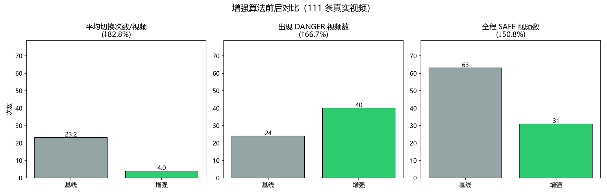 
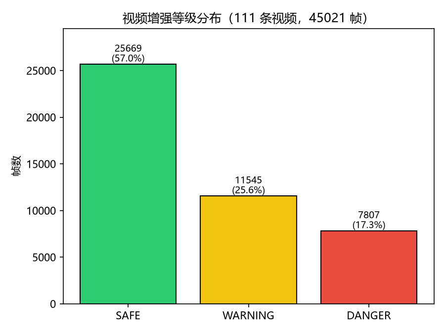
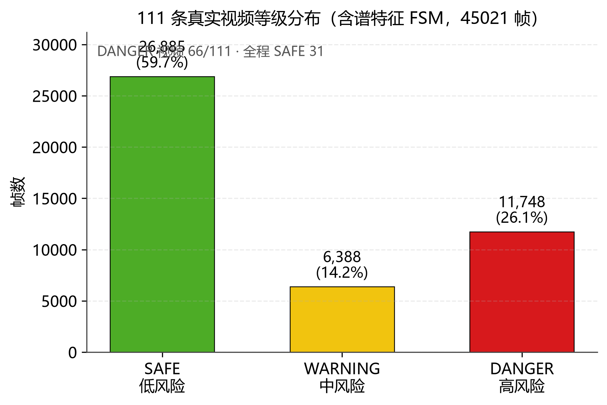
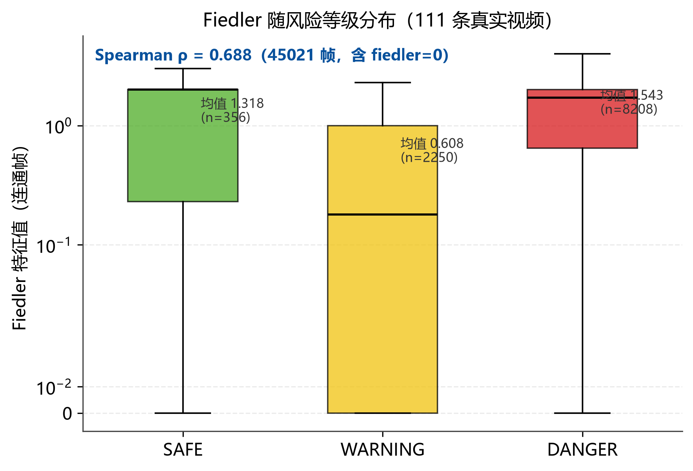
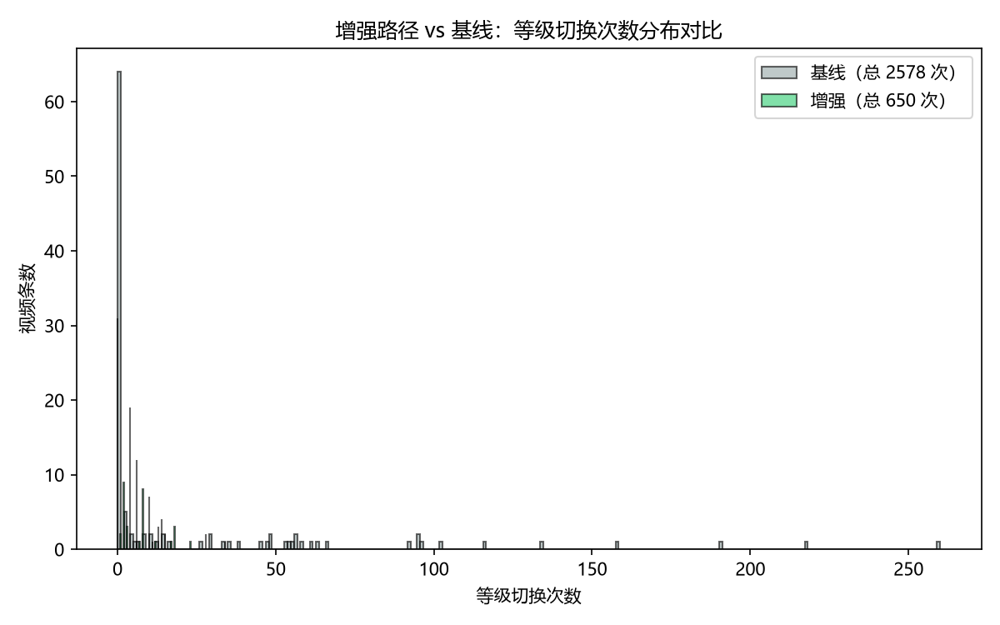
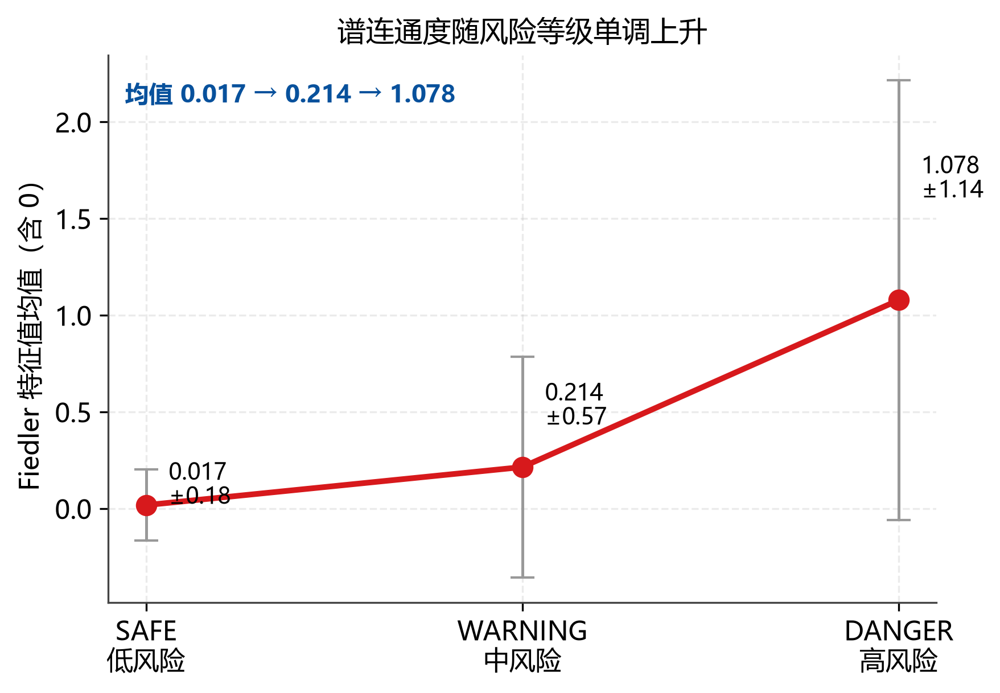
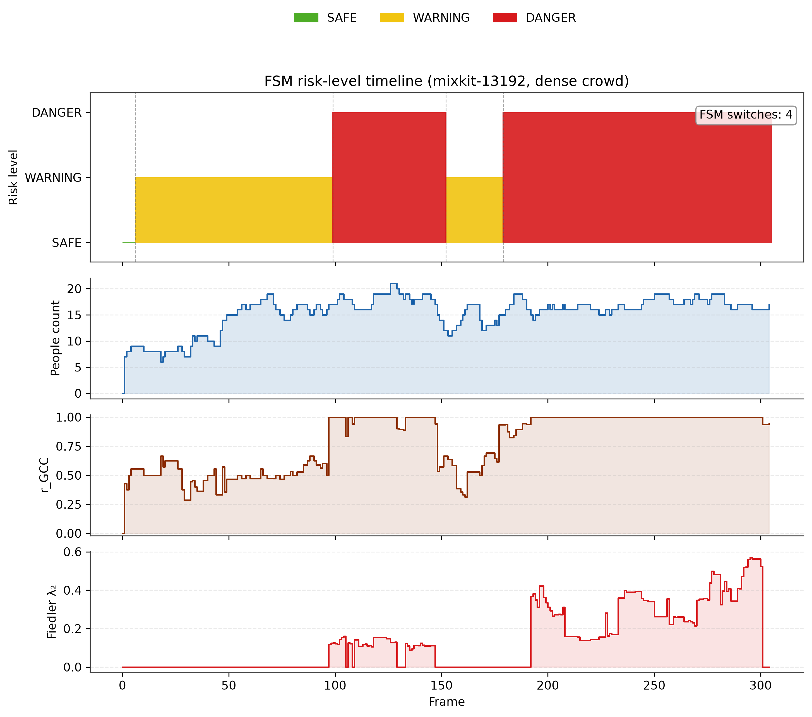
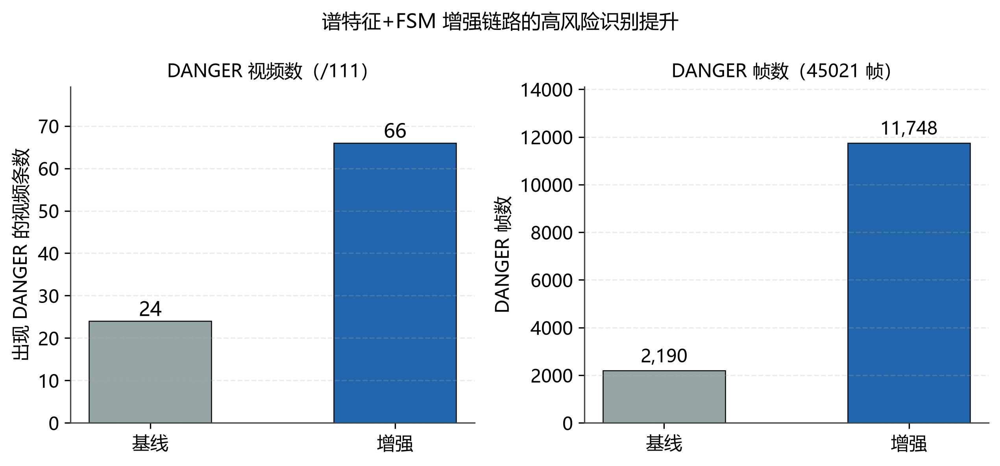
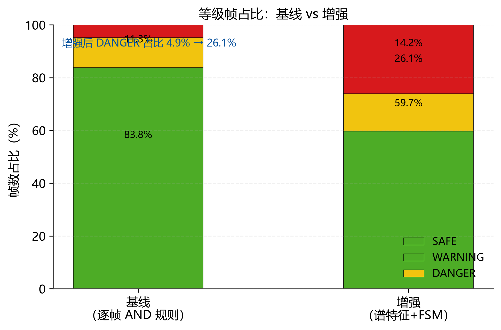

> 数据挖掘结论：Fiedler 与风险等级的 **Spearman ρ = 0.688**（45021 帧全量），谱连通度与人群聚集风险显著正相关。

### 消融实验（各组件贡献，6 条代表性视频）

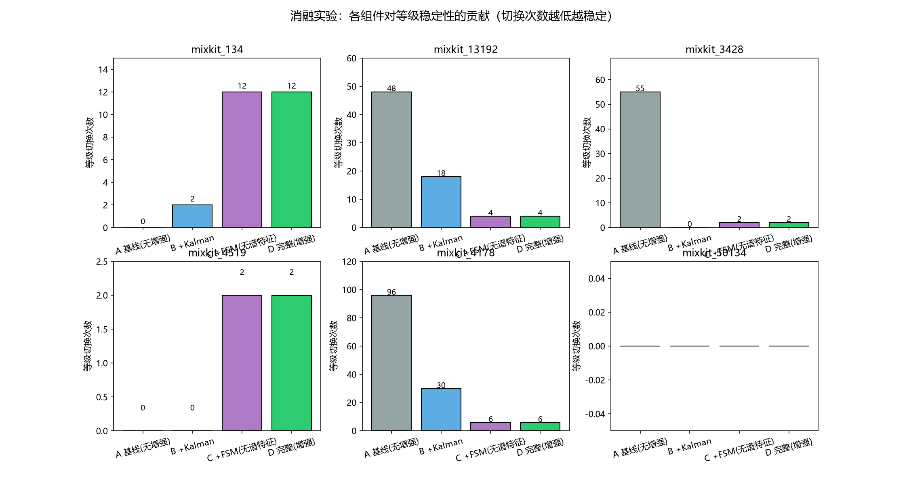

- **A 基线（无增强）**：平均切换 33.2 次
- **B +Kalman 平滑**：→ 8.3 次（↓75%）
- **C +FSM（无谱特征）**：→ 4.3 次（↓87%）——FSM 滞回/确认帧/DANGER 保持带来主要稳定性
- **D 完整（+谱特征 +FSM）**：→ 4.3 次保持稳定，且 **DANGER 帧提升 +152 帧（相对 C 组 +10.2%）**（mixkit_4519 +78、mixkit_4178 +45、mixkit_134 +29），谱特征在中等/密集聚集场景显著提升高风险识别，对极密（mixkit_3428）与稀疏（mixkit_50134）无副作用

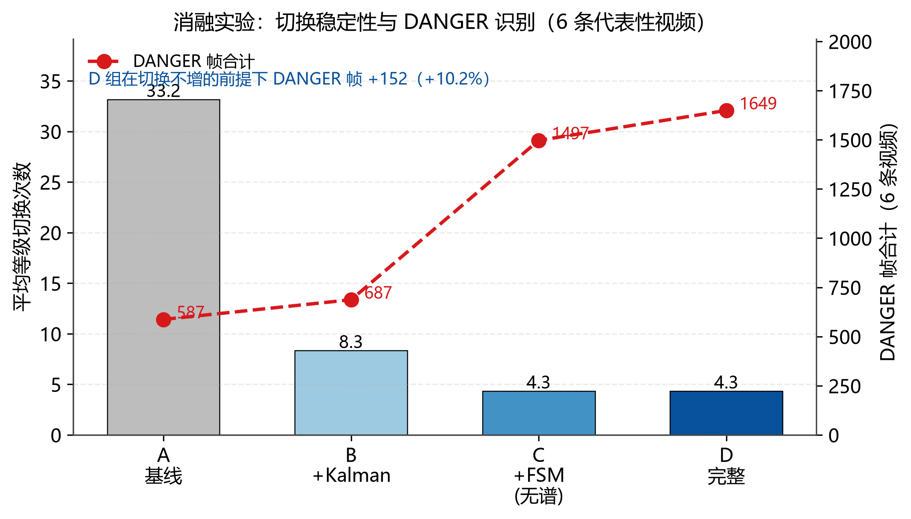

详见 `results/rerun/_ablation.json` 与 `docs/figures/fig_ablation_pro.png`。

### ⚡ 真机性能（Luckfox Pico Max / RV1106）

| 指标 | 结果 |
|---|---|
| 帧率（NEON 优化后） | **6.30 → 7.46 FPS（+18%）** |
| CPU 预处理耗时（letterbox+RGB） | **136ms → 33ms（-76%，NEON）** |
| 内存占用（RSS） | **~10.5-10.9MB** |
| 长稳（systemd 看门狗 + 有限超时） | **28 小时+ 采样（10 点）：看门狗 0 介入、日志 0 错误**（板子曾外部重启 1 次，systemd 自动恢复；当前进程连续运行 6h+） |
| 板端黄金测试 | **174/174 通过**（NEON vs 标量对照） |
| 主链路保护 | VI/VENC 1s 有限超时、连续失败 30 次主动退出交由看门狗重启 |

性能打点日志与长稳快照见 `results/edge_board/`。

### 🎬 真实检测效果视频

**增强算法效果视频**（点击封面观看，真实视频处理结果）：

- 人群聚集场景（SAFE → WARNING → DANGER 风险过渡，FSM 稳定）：
 [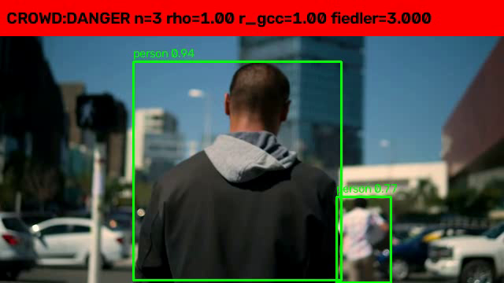](results/demo/mixkit_134_enhanced.mp4)

- 稀疏/无人场景（真实少人，未触发告警）：
 [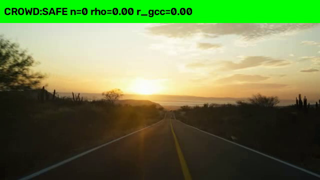](results/demo/mixkit_50134_enhanced.mp4)

> 视频为真实数据集（Mixkit）经 `scripts/crowd_test_enhanced.py`（Kalman + FSM）处理生成；逐帧时间线 JSON 在 `results/rerun/video_enhanced/`（谱特征接入后的规范结果）。

性能对比图表见 `docs/figures/`。

## 🚀 部署方法

### PC 端测试（GPU，用于实验）
```bash
# 图片基线
python scripts/crowd_test.py --input dataset/images500 --output results/images500_baseline --device 0
# 视频增强（Kalman + FSM）
python scripts/crowd_test_enhanced.py --input <video.mp4> --output results/video_enhanced --spectral --device 0
```

### 开发板部署（Luckfox RV1106，C++/RKNN）
1. 老电脑（Ubuntu）用交叉编译工具链编译 `src/luckfox_rtsp_yolov5/` 工程（架构见 `docs/ARCHITECTURE.md`，硬件方案见 `docs/hardware/`）
2. 产物 scp 到开发板，`sudo ./luckfox_pico_rtsp_yolov5` 运行（systemd 托管 + 看门狗自动重启）
3. RTSP 推流：`rtsp://<板子IP>:554/live/0`
4. 算法模块（图论/Kalman/FSM）的 C++ 头文件在 `src/algorithms/*.h`，可交叉编译集成
5. **一键启动**：`sudo bash scripts/start_demo.sh` 自动拉起 RTSP + 网页观看并打印访问地址（见 `docs/WEB_VIEWER.md`）

### C++ 算法主机测试与构建（无需开发板）
```bash
cd src/luckfox_rtsp_yolov5
make test # 编译并运行增强决策/JSON 配置/阈值引擎单元测试（仅需 g++）
# 等价 CMake 方式：
# cmake -S . -B build && cmake --build build && ctest --test-dir build
```
- 测试覆盖：`EnhancedDecision`（Kalman+FSM 确定性输出）、`minijson` JSON 解析、`RiskConfig` 运行时阈值读取、`Preprocess` NEON vs 标量对照、**硬件驱动模块 118 项**（GPIO/LED/按键/舵机云台/语音告警）+ **硬件自检 80 项**（GPIO 写读回/PWM/SPI 屏幕 ID/USB 声卡/WiFi/按键的 PASS/FAIL 判定与容错）+ **触摸屏菜单 99 项**（页面导航/四键/风险颜色映射/参数刷新节流/NULL 容错）+ **ILI9341 显示驱动 123 项**（复位/初始化命令序列/窗口参数/矩形填充裁剪/帧缓冲/flush/读 ID）+ **XPT2046 触摸驱动 98 项**（命令协议/12 位数据提取/PENIRQ+压力阈值判定/校准坐标转换/中值抗噪/故障注入），全部用内存替身测试，无需真实硬件；**Linux 板端适配层 40 项**（spidev 打开/关闭/传输失败路径、DC/RESET/背光/PENIRQ 电平逻辑与 NULL 容错，`make test` 在 Linux/CI 自动纳入）；**go2rtc demo 流配置工具 18 项**（YAML 行级编辑：新增保留 cam/幂等/更新替换/损坏重建/自动备份/dry-run/CLI 返回码，`tests/test_go2rtc_demo_config.py`，其中 4 项 shell 脚本测试在 Linux/CI 执行）。
- 交叉编译完整工程：`make luckfox LUCKFOX_SDK_ROOT=<SDK路径>`（需 Luckfox SDK 库与工具链）。
- 阈值通过 `config/default_config.json` 运行时加载（`RiskEngine::setConfig`），失败自动回退默认值，“可配置”承诺在 C++ 端落地。


## 🔧 2026-10-30 关键修复（Hub多Agent审计）

| Bug | 严重度 | 修复 |
|-----|--------|------|
| NMS classIds下标错误 | P0 | `classIds[order[i]]` / `classIds[m]` |
| 脚点坐标去重缺失 | P0 | 2cm容差去重(C++/Python双端) |
| min_danger_n=3门控 | P0 | n<3永不升DANGER |
| Jacobi n≥10不收敛 | P0 | 单主元→循环收敛 |
| letterbox每帧2MB malloc | P1 | 预分配常驻缓冲 |

详见 `docs/review/20261030_hub/FIXES_APPLIED.md` 和 `docs/review/20261030_hub/perf_analysis_opencode.md`

## 📚 文档索引

| 文档 | 内容 |
|---|---|
| `docs/工作日志.md` | 开发进度日志（时间/改动/commit/进度） |
| `docs/SYSTEM_PRINCIPLE.md` | 系统实现原理与算法详解 |
| `docs/ARCHITECTURE.md` | 系统架构与模块划分 |
| `docs/algorithms.md` | 算法设计（C++/Python 双实现、黄金回归说明） |
| `docs/WEB_VIEWER.md` | 网页免安装观看监控（go2rtc，手机/电脑浏览器）+ 本地视频 demo 流兜底（P2-1） |
| `docs/DEMO_VIDEO.md` | 真实检测效果视频说明 |
| `docs/LUCKFOX_VOICE_ASSISTANT_PLAN.md` | 语音对话大模型方案（网络/本地双方案） |
| `docs/hardware/` | 硬件扩展（LED/按键/舵机/语音/大屏/开关/PCB） |
| `docs/hardware/led_button_driver.md` | 三色 LED + 按键驱动（GPIO 抽象、颜色映射、防抖、测试） |
| `docs/hardware/tracking_servo.md` | 双舵机云台跟踪（PWM 抽象、角度换算、PanTilt 控制、测试） |
| `docs/hardware/voice_module.md` | 语音告警方案（USB 喇叭推荐 / DFPlayer 兜底）与播报策略 |
| `docs/hardware/selftest.md` | 开机硬件自检（6 项 PASS/FAIL、systemd 门禁、部署步骤） |
| `docs/hardware/lvgl_menu.md` | 触摸屏菜单方案（LVGL 移植调研、菜单状态机框架、99 项测试、板端适配路线） |
| `docs/hardware/lvgl_board_port.md` | 板端 LVGL 移植准备（ILI9341 接入草案：**方案 C Luckfox 动态 overlay 已真机落地**——`scripts/enable_spi0_overlay.sh` 一键启用 `/dev/spidev0.0`，systemd 开机自动加载 + udev 0666 权限，2026-10-28 实测：ioctl mode0/1MHz 成功、重启自动恢复；ILI9341 显示驱动 + XPT2046 触摸驱动 + **Linux 板端适配层**（`src/hardware/sysfs_spi.{h,cc}`，已在开发板 armv7l 编译运行通过）均已实现，剩余为 ILI9341 到货后接线与校准） |

## 🧩 可扩展模块（后续）

- **语音对话大模型**（网络/本地双方案）：`docs/LUCKFOX_VOICE_ASSISTANT_PLAN.md`
- **PCB 底板打样**：`docs/hardware/PCB_BOARD_DESIGN.md`
- **DBSCAN 人群聚类 / ByteTrack 跟踪 / EMA 平滑**：独立实现并通过单测（`src/algorithms/`），可按需接入主循环

## 📌 说明

- 所有实验数据均来自真实数据集，可复现。
- 论文/答辩/评审类内部文档仅保存在本地（`H:\毕设论文\`），不入库；GitHub 仅保留代码、配置、测试与技术文档。