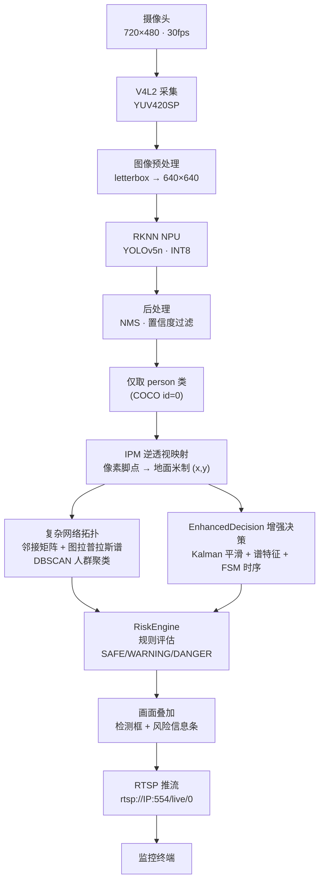
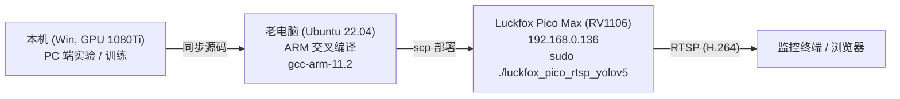

# 系统架构设计文档

> 对应项目《基于 C++ 的边缘端轻量化行人感知与风险决策软件系统设计》
> 本文描述系统总体架构、数据流、算法模块与部署拓扑，是代码与论文的桥梁。

## 1. 系统概述

系统在 **Luckfox Pico Max（RV1106）** 单板（256MB RAM、1 TOPS NPU、单核 Cortex-A7 1.2GHz）上，以 C++/RKNN 实时运行 **YOLOv5n（INT8）行人检测**，结合 **IPM 几何校正**、**复杂网络拓扑分析**（图拉普拉斯谱 + DBSCAN 聚类）与 **时序风险决策**（Kalman 平滑 + FSM 有限状态机），最终输出 **SAFE / WARNING / DANGER** 三级风险，并通过 RTSP 推流叠加画面。

设计约束：**边缘端资源极有限**（256MB 内存、1TOPS NPU），因此核心推理与决策全部使用 **C++** 实现，算法头文件均为 **header-only C++11**（无第三方依赖，仅标准库），可在 ARM 交叉编译器下编译运行。

## 2. 总体架构图



**两条并行决策路径**：
- **基础路径（RiskEngine）**：复杂网络特征（density/r_gcc/聚类系数）+ 固定规则阈值 → 快速分级。
- **增强路径（EnhancedDecision）**：Kalman 多目标平滑 → 图拉普拉斯谱特征（Fiedler 等）→ FSM 状态机（滞回/去抖/保持）→ 稳定分级，抑制瞬时聚集误报、消除帧间闪烁。

## 3. 分层架构说明

### 3.1 感知层（轻量化检测）
- 模型：YOLOv5n + INT8 量化，约 7.5MB，部署于 RV1106 NPU。
- 后处理：NMS 去重，置信度过滤，仅保留 `cls_id==0`（person）。
- 关键代码：`src/luckfox_rtsp_yolov5/`（`yolov5.cc`、`postprocess.cc`、`luckfox_mpi.cc`）。

### 3.2 几何层（IPM 逆透视映射）
- 用 `cv::getPerspectiveTransform` 将画面底部地面梯形（近大远小）映射到地面 6m×4m 米制坐标。
- 行人脚点（box 底边中心）经单应矩阵 H 映射为地面坐标 `(x,y)`，消除透视畸变对"距离/密度"的影响。
- 关键代码：`main.cc::mapCoordinates()`、`src/algorithms/ipm_calibrate.py`。

### 3.3 拓扑层（复杂网络分析）
- 以地面米制坐标为节点，按 `edge_dist`（默认 2.0m）建邻接矩阵。
- 计算图拉普拉斯 `L = D - A` 谱特征：Fiedler 值、谱半径、代数连通度、特征熵、聚类系数、网络密度 `r_gcc`。
- DBSCAN 对脚点聚类，识别"人群簇"及其规模。
- 关键代码：`src/algorithms/graph_laplacian.h`、`src/algorithms/crowd_dbscan.h`。

### 3.4 决策层（时序 + 规则）
- **RiskEngine**：特征 → 阈值规则（`config/default_config.json` 可配）→ 三级风险。
- **EnhancedDecision**：Kalman 多目标平滑（最近邻关联）→ 谱特征 → FSM 有限状态机（滞回防抖、状态保持）→ 稳定等级。
- 关键代码：`src/algorithms/kalman_filter.h`、`risk_fsm.h`、`src/luckfox_rtsp_yolov5/src/enhanced_decision.cc`。

### 3.5 输出层
- 叠加检测框（绿/黄/红对应 SAFE/WARNING/DANGER）与风险信息条。
- RTSP（H.264）推流，供局域网监控终端查看。

## 4. 端到端数据流

```
摄像头帧(720×480 YUV) → letterbox(640×640) → NPU推理
  → NMS → person 检测框(left,top,right,bottom,prop)
  → 脚点 (px, py) = (水平中心, 框底边)
  → IPM: mapCoordinates → 地面米制 (gx, gy)
  → 收集 groundPts[]
  → (A) riskEngine.addPedestrian → computeFeatures → evaluate → CrowdLevel
  → (B) enhancedDecision.processFrame(groundPts) → EnhancedResult{level,n,density,r_gcc,fiedler}
  → 画框 + 风险信息条 → RTSP
```

## 5. 模块清单

| 模块 | 文件 | 说明 |
|---|---|---|
| 图拉普拉斯谱分析 | `src/algorithms/graph_laplacian.h` | 邻接矩阵、L=D-A、Fiedler/谱半径/代数连通度/特征熵 |
| Kalman 滤波 | `src/algorithms/kalman_filter.h` | 线性匀速单目标滤波 |
| 风险 FSM 状态机 | `src/algorithms/risk_fsm.h` | 滞回/去抖/保持，输出稳定等级 |
| ByteTrack 跟踪 | `src/algorithms/bytetrack_tracker.h` | 多目标关联（升级） |
| DBSCAN 聚类 | `src/algorithms/crowd_dbscan.h` | 人群簇识别 |
| EMA 平滑 | `src/algorithms/ema_smoother.h` | 时序平滑（升级） |
| 增强决策模块 | `src/luckfox_rtsp_yolov5/src/enhanced_decision.cc` | 组合 Kalman+谱特征+FSM，板端 C++ 旁路 |
| 开发板工程 | `src/luckfox_rtsp_yolov5/` | RKNN/RTSP/画框主程序 |
| 规则配置 | `config/default_config.json` | 阈值可配置 |
| PC 实验脚本 | `scripts/crowd_test.py`、`crowd_test_enhanced.py` | 图片/视频基线+增强实验 |

## 6. 部署拓扑



- 本机（GPU）负责大规模真实数据集实验与算法验证。
- 老电脑负责 ARM 交叉编译 `arm-none-linux-gnueabihf-g++`。
- 开发板运行最终 C++ 程序并 RTSP 推流。

## 7. 配置说明

`config/default_config.json`：

| 参数 | 默认 | 含义 |
|---|---|---|
| `edge_dist` | 2.0 m | 建图邻接距离阈值 |
| `danger.n` | 10 | DANGER 最少人数 |
| `danger.rho` | 0.55 | DANGER 密度阈值 |
| `danger.gcc` | 0.80 | DANGER 聚类系数阈值 |
| `warning.n` | 5 | WARNING 最少人数 |
| `warning.rho` | 0.28 | WARNING 密度阈值 |
| `warning.gcc` | 0.55 | WARNING 聚类系数阈值 |

## 8. 关键技术指标（真实实验）

| 实验 | 指标 | 结果 |
|---|---|---|
| 500 张 COCO 真实图片基线 | 检出率 | **82.5%** |
| 高密度（14+人） | 检出率 | **79.4%** |
| 密集人群视频增强 | DANGER 稳定帧 | 264/305，切换仅 4 次 |
| 稀疏/无人场景 | 误报 | **0 次** |

所有数据来自真实公开数据集（COCO 2017 图片、Mixkit 视频）实际运行，无任何合成/编造。

## 9. 相关文档

- `docs/SYSTEM_PRINCIPLE.md` — 系统实现原理与算法详解
- `docs/ALGORITHM_OPTIMIZATION.md` — 算法优化建议
- `docs/ALGORITHM_UPGRADE.md` — 升级说明（ByteTrack/DBSCAN/IPM/EMA）
- `docs/INTEGRATION_PLAN.md` — 集成方案
- `docs/PERFORMANCE_COMPARISON.md` — 性能对比实验报告