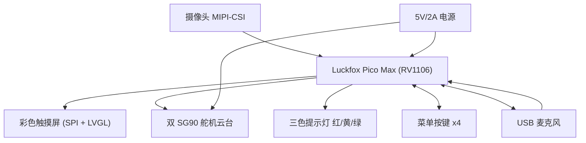

# 触控屏幕菜单 + 语音识别 + 双舵机云台 + 三色提示灯 + 按键 硬件扩展方案

> 针对 Luckfox Pico Max（RV1106）系统的完整交互升级方案。
> 目标：彩色触控屏显示**动画菜单**与**摄像头检测画面**；语音/按键开启程序；菜单显示**网络地址、CPU 占用率**等参数；按键返回；双舵机云台 + 三色灯联动。

---

## 1. 系统总览



**交互流程**：
1. 开机进入**主菜单**（动画：图标 + 标题滚动 + 参数栏）。
2. 说唤醒词/命令词（如"开启检测"）**或**按键（上/下/确定）进入检测程序。
3. 检测程序：屏幕显示**摄像头实时画面 + 检测框 + 风险等级**，三色灯同步亮对应颜色，舵机云台可追踪。
4. 按"返回"键退出到主菜单；菜单页显示 IP、CPU、内存、帧率等参数。

---

## 2. 硬件选型与说明

### 2.1 彩色触摸屏（核心）

| 项 | 推荐 | 说明 |
|---|---|---|
| 屏幕 | **2.8 寸 ILI9341 SPI 触摸屏（320×240）** | 社区验证成熟（ST7735/ILI9341 均有 Luckfox 驱动教程），价格低 |
| 触摸 | XPT2046 电阻触摸（板上集成） | SPI 读取触摸坐标，LVGL 有现成驱动 |
| 备选 | 1.69 寸 ST7789（240×280，约 10 元） | 更便宜，屏幕略小 |
| 显示摄像头画面 | 缩略图模式（如 160×120 居中） | SPI 带宽有限，菜单+小画面流畅 |

> **为什么不用大屏/HDMI**：RV1106 无 HDMI 输出；官方 DSI 屏（13.3 寸）为 Pico Ultra 适配，Max 未验证。SPI 屏 + LVGL 是 RV1106 性价比最高的 GUI 方案。

### 2.2 语音识别模块

| 项 | 推荐 | 说明 |
|---|---|---|
| 麦克风 | **USB 免驱麦克风** | Luckfox 可配 USB HOST 模式，即插即用（ALSA），无需额外电路 |
| 识别引擎 | **sherpa-onnx（离线）** | 支持 arm32（armv7），有中文 Zipformer 14M 模型（专为 Cortex A7 优化） |
| 命令词 | 离线 Keyword Spotting / 流式 ASR | "开启检测 / 关闭检测 / 返回菜单" 等 |
| 备选 | INMP441 I2S 麦克风（约 5 元） | 需 I2S 引脚 + 驱动，更省电但接线复杂，**推荐先走 USB** |

### 2.3 舵机云台（需购买 2 个 SG90）

- 两个 SG90：水平 + 垂直，构成摄像头二自由度云台。
- 控制：PWM（50Hz，0.5~2.5ms 对应 0~180°）。
- **供电注意**：SG90 堵转电流可达 ~500mA，**必须独立 5V 供电**（不能从 3.3V 引脚取），与开发板**共地**。

### 2.4 三色提示灯

- 红/黄/绿三颗 LED（或一个 RGB LED），分别对应 DANGER / WARNING / SAFE。
- 接 GPIO + **330Ω 限流电阻**，低电平点亮或高电平点亮视 GPIO 而定。

### 2.5 菜单按键

- 4 个轻触按键：**上 / 下 / 确定 / 返回**。
- 接 GPIO，输入模式带上拉（内部上拉），按下次沿触发。

---

## 3. 引脚分配与接线图

> 具体 GPIO 编号需用板子上的 `luckfox-config` 确认复用（SPI/PWM/GPIO）。以下为**推荐功能分配**（40pin 兼容 Raspberry Pi Pico 布局）。

| 功能 | 引脚（示例，以 luckfox-config 实际为准） | 说明 |
|---|---|---|
| 屏幕 SPI0_SCK | SPI0_SCLK | 时钟 |
| 屏幕 SPI0_MOSI | SPI0_MOSI | 数据 |
| 屏幕 CS | GPIO 片选（自定义） | 片选 |
| 屏幕 DC | GPIO（自定义） | 数据/命令 |
| 屏幕 RST | GPIO（自定义） | 复位 |
| 屏幕 BL | GPIO（PWM 可调背光） | 背光 |
| 触摸 XPT2046 | SPI1 或 GPIO 模拟 SPI | CS/CLK/MOSI/MISO/IRQ |
| 舵机1（水平） | PWM0 | 50Hz 方波 |
| 舵机2（垂直） | PWM1（或 GPIO 软 PWM） | 50Hz 方波 |
| 三色灯 红 | GPIO（如 GPIO22） | 串 330Ω 到 GND |
| 三色灯 黄 | GPIO（如 GPIO23） | 同上 |
| 三色灯 绿 | GPIO（如 GPIO24） | 同上 |
| 按键 上/下/确定/返回 | GPIO（如 18/19/20/21） | 内部上拉，按下接地 |
| USB 麦克风 | USB1（HOST 模式） | 即插即用 |

### 接线图（示意）

```
 Luckfox Pico Max (RV1106)
 ┌─────────────────────────────────────────────────────────────┐
 │ │
 │ 3V3 ──────► LCD VCC (3.3V) USB1 ────► USB 麦克风 (免驱) │
 │ GND ──────► LCD GND │
 │ SPI0_SCLK ─► LCD SCK PWM0 ────► 舵机1 信号 (水平) │
 │ SPI0_MOSI ─► LCD MOSI PWM1 ────► 舵机2 信号 (垂直) │
 │ GPIO_CS ───► LCD CS │
 │ GPIO_DC ───► LCD DC GPIO22 ──► 330Ω ──► 红灯 LED │
 │ GPIO_RST ──► LCD RST GPIO23 ──► 330Ω ──► 黄灯 LED │
 │ GPIO_BL ────► LCD BL GPIO24 ──► 330Ω ──► 绿灯 LED │
 │ │
 │ SPI1_CS ────► XPT2046 CS GPIO18 ──► 按键(上) │
 │ SPI1_CLK ───► XPT2046 CLK GPIO19 ──► 按键(下) │
 │ SPI1_MOSI ──► XPT2046 DIN GPIO20 ──► 按键(确定) │
 │ SPI1_MISO ──► XPT2046 DOUT GPIO21 ──► 按键(返回) │
 │ GPIO_IRQ ───► XPT2046 IRQ │
 └─────────────────────────────────────────────────────────────┘
 │
 5V/2A 电源 ──┬──► Luckfox 5V 输入（Type-C/Power）
 └──► 舵机 5V 供电（独立，共地）
```

**关键接线要点**：
- **舵机独立供电**：舵机 VCC 接 5V/2A 电源，GND 与开发板 GND 共地；信号线接 PWM。
- **LED 限流**：每颗 LED 串 330Ω 电阻。
- **按键上拉**：GPIO 内部上拉，按键另一端接 GND。
- **屏幕供电**：ILI9341 模块通常 3.3V（部分兼容 5V，**务必看模块标注**，插错可能烧屏）。

---

## 4. PCB 扩展底板设计

在现有 `docs/hardware/PCB_BOARD_DESIGN.md` 基础上，扩展底板增加：

1. **舵机接口**：3P 排针（5V / GND / 信号）×2，带 100μF 电容滤波。
2. **LED 电路**：3 路（GPIO → 330Ω → LED → GND），板载 LED 或外接排针。
3. **按键接口**：4 路（GPIO → 按键 → GND），板载轻触按键 + 上拉。
4. **USB 麦克风**：引 USB1 为标准 USB-A 母座。
5. **屏幕排针**：SPI + 触摸的 2.54mm 排针座（与屏幕模块对应）。

**PCB 规格建议**：
- 尺寸：100×80mm（嘉立创 10×10cm 内免费/低价打样）
- 供电分轨：5V 输入 → AMS1117-3.3 给逻辑；舵机 5V 直通（加保险丝/电容）
- 接口丝印标注清晰

详见 `docs/hardware/PCB_BOARD_DESIGN.md`（可合并本方案）。

---

## 5. 软件实现方案

### 5.1 图形界面（LVGL）

- 移植 **LVGL v8**（或 v9）到 Luckfox，屏幕驱动 ILI9341（Linux framebuffer 或 SPI 直接驱动）。
- **动画菜单**：
 - 主菜单：图标 + 标题，滚动文字动画，参数栏（IP/CPU/内存/帧率）定时刷新。
 - 子菜单：检测画面（摄像头缩略图）、设置、关于。
- **摄像头画面**：检测循环里的 `cv::Mat frame`（720×480 BGR）缩放到 160×120 → 转 RGB565 → 通过 LVGL image 控件显示（SPI 屏帧率约几 FPS，可接受）。

### 5.2 语音识别（sherpa-onnx）

- 交叉编译 sherpa-onnx（armv7）到板子。
- 下载中文命令词/流式模型（`sherpa-onnx-streaming-zipformer-zh-14M`，约 14MB，Cortex A7 可跑）。
- 用 `sherpa-onnx-alsa` 接 USB 麦克风，识别命令词：
 - "开启检测" → 启动检测程序
 - "关闭检测" → 停止
 - "返回菜单" → 回到主菜单
- 识别结果通过回调/共享标志通知主程序切换界面。

### 5.3 参数显示

- **IP 地址**：读取 `/proc/net/route` 或 `ioctl`（eth0）获取。
- **CPU 占用率**：两次读取 `/proc/stat` 计算。
- **内存**：读取 `/proc/meminfo`。
- 帧率：统计主循环处理帧数/秒。
- 每 500ms 刷新一次 LVGL label。

### 5.4 舵机云台

- 两个 PWM 通道输出 50Hz，0~180°。
- 可手动（按键/菜单控制）或自动（根据检测目标中心位置 PID 跟踪）。

### 5.5 三色灯联动

- 风险等级（SAFE/WARNING/DANGER）→ 点亮绿/黄/红灯（与画框颜色一致）。
- 无检测时绿灯常亮。

---

## 6. 性价比物料清单（按此购买）

| # | 物料 | 规格 | 数量 | 参考价(元) | 说明 |
|---|---|---|---|---|---|
| 1 | 2.8 寸 ILI9341 SPI 触摸屏 | 320×240，带 XPT2046 | 1 | 25~35 | 屏幕模块+触摸 |
| 2 | USB 麦克风 | 免驱，USB-A | 1 | 10~15 | 接 USB1 HOST |
| 3 | SG90 舵机 | 9g，0~180° | 2 | 12~16（6~8/个） | 需购买 |
| 4 | 三色 LED 模块 / LED | 红黄绿 | 1 套 | 3~5 | 或 5mm LED×3 + 330Ω×3 |
| 5 | 轻触按键 | 6×6mm | 4 | 1~2 | 上/下/确定/返回 |
| 6 | 5V/2A 电源适配器 | 5V 2A Type-C/DC | 1 | 10~15 | 舵机+板供电 |
| 7 | AMS1117-3.3 稳压模块 | 可选 | 1 | 2 | 若屏幕需 3.3V 独立 |
| 8 | 扩展 PCB 打样 | 嘉立创 10×10cm | 5 片 | 20~30 | 按第 4 节规格 |
| 9 | 排针/杜邦线/端子 | 2.54mm | 若干 | 5~10 | 接线用 |
| 10 | USB-A 母座转接 | 接麦克风 | 1 | 2~3 | 底板引 USB |

**合计（不含已有板子，含舵机）：约 100~150 元**。
**可选加分项**：1.69 寸 ST7789 屏（10 元，预算紧张时替换）。

> 价格参考 2026 年淘宝/立创常规价，实际以购买页面为准。

---

## 7. 实施步骤（分阶段）

1. **阶段 A（显示菜单）**：点亮 ILI9341 → 移植 LVGL → 跑通动画主菜单 + 参数显示。
2. **阶段 B（摄像头画面）**：把检测帧缩略图送 LVGL 显示，叠加风险等级。
3. **阶段 C（语音）**：交叉编译 sherpa-onnx → USB 麦克风 → 命令词开启/关闭程序。
4. **阶段 D（控制）**：双舵机 PWM 云台 + 三色灯联动 + 按键导航/返回。
5. **阶段 E（整合）**：PCB 扩展底板焊接，全部功能联调。

每完成一阶段即**更新 GitHub 并推送**（代码、接线图、进度）。

---

## 8. 风险与注意事项

- **屏幕供电电压**：ILI9341 模块 3.3V 与 5V 版本不同，**插错易烧**；购买时确认。
- **SPI 屏帧率**：显示摄像头实时画面帧率有限（几 FPS），用缩略图模式保证菜单流畅。
- **舵机供电**：必须独立 5V，否则复位/死机；两个 SG90 同时动作建议 5V/2A。
- **USB 麦克风**：配置 USB HOST 后虚拟网口失效，改用 SSH/串口登录。
- **引脚复用冲突**：SPI/PWM/GPIO 需用 `luckfox-config` 先确认，避免冲突。
- **sherpa-onnx 编译**：armv7 交叉编译较耗时，建议先用板子原生环境或预编译包，跑通再优化。